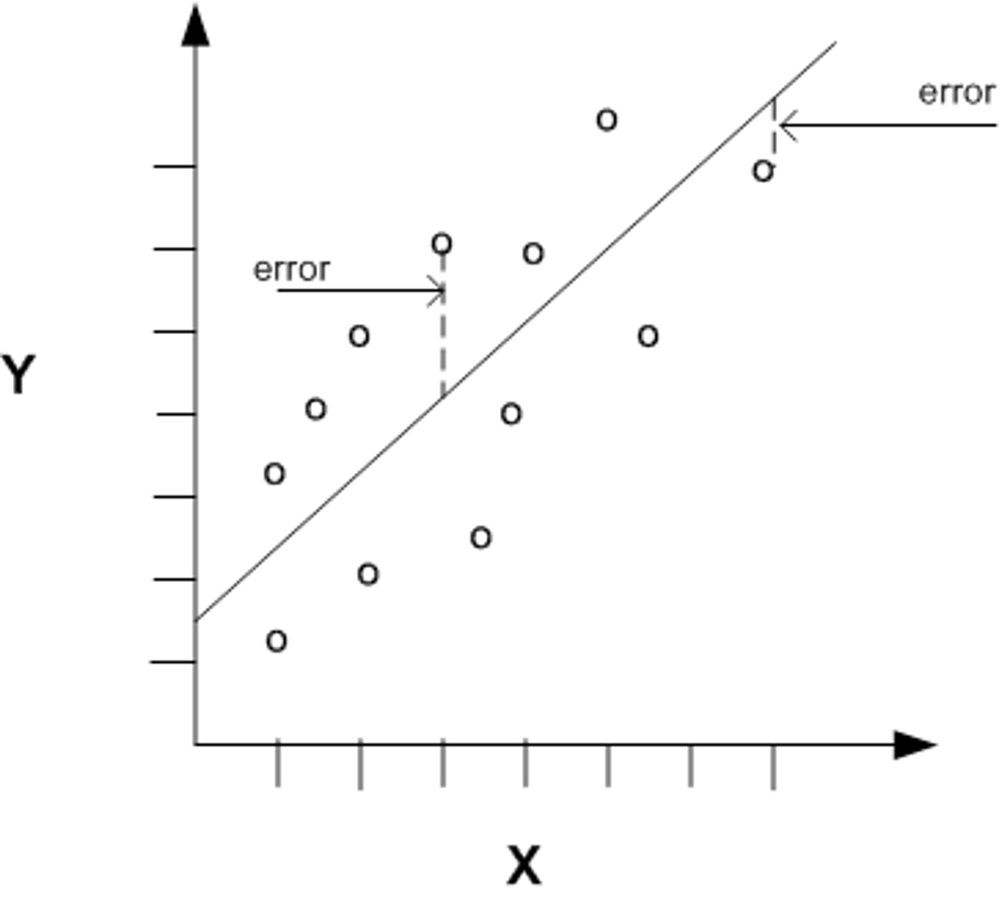
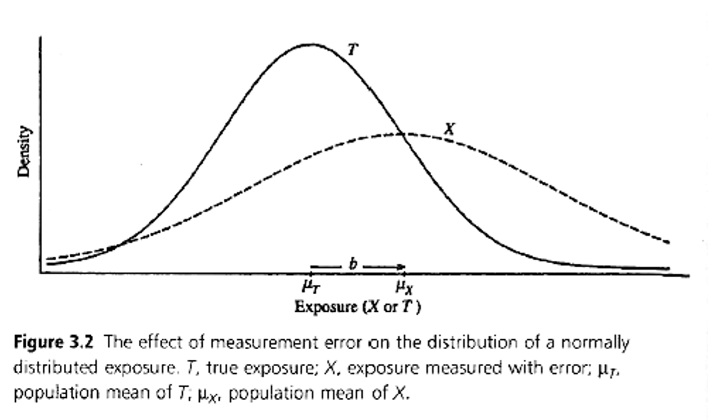
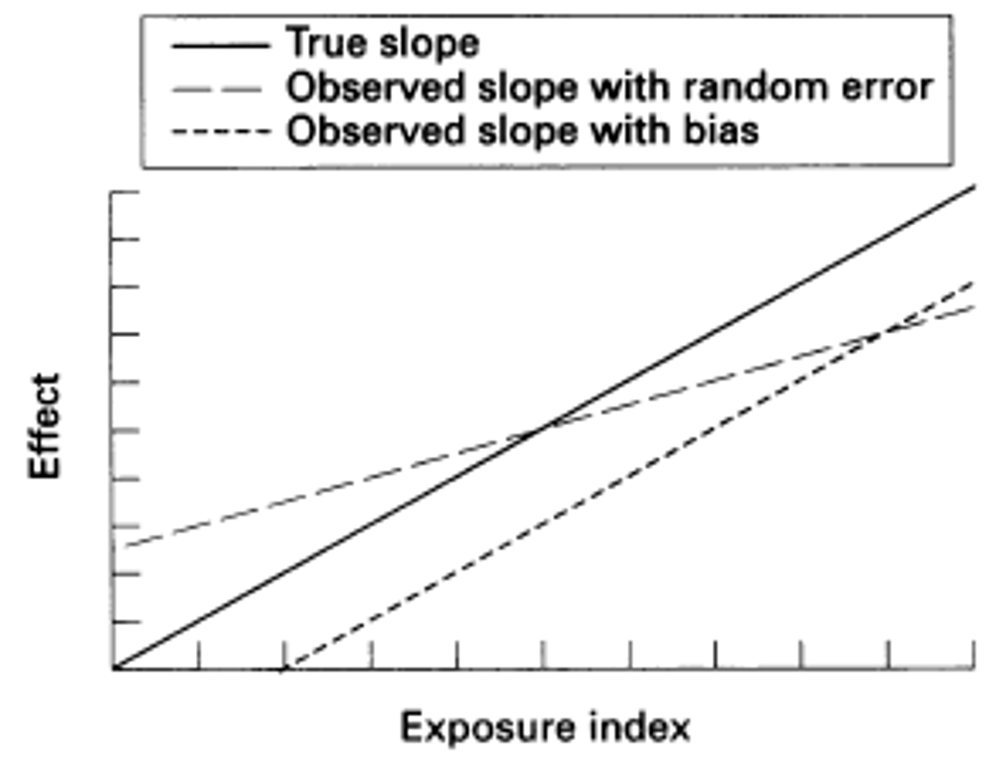
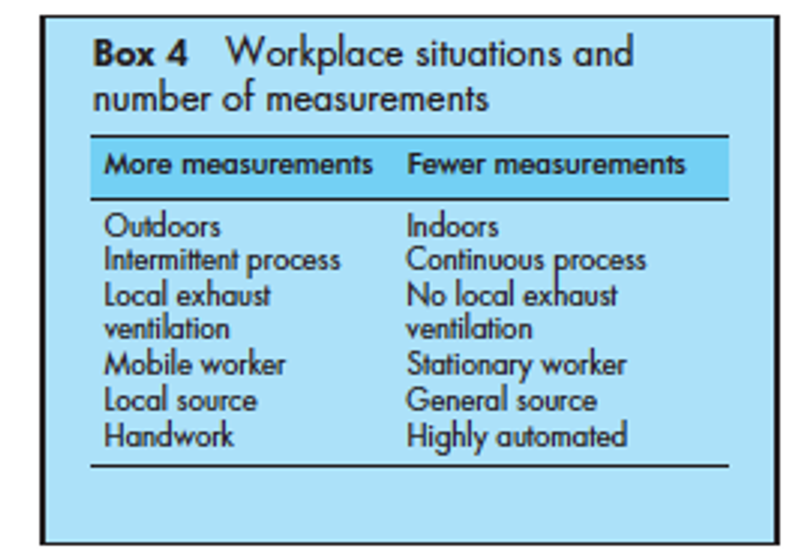

::: {.content-visible when-format="revealjs"}

------------------------------------------------------------------------

## Lecture 10: Comparing imperfect measures

------------------------------------------------------------------------
:::

::: {.content-hidden when-format="revealjs"}
```{r, message=FALSE, warning=FALSE}
#| code-fold: true
#| code-summary: "Click to view catchup R code"

# set your working directory with `setwd()`!!

# load packages we need
library(tidyverse) # data manipulation and plotting
library(readxl) # reading in our excel dataset
library(janitor) # cleaning columns names and more

# set the theme of all ggplots to `theme_minimal()`
theme_set(theme_minimal())

# read dataset excel file and make sure it's a tibble
ehs655 <- read_xlsx("Dataset V1.xlsx") %>% as_tibble()

# make all column names lowercase and snake_case
ehs655 <- ehs655 %>% clean_names()

# clean job title variable to remove misspellings
ehs655 <- ehs655 %>%
  mutate(
    job_title = 
      case_when(
        job_title == "Lborer" ~ "Laborer",
        job_title == "Laboerr" ~ "Laborer",
        job_title == "Electrican" ~ "Electrician",
        job_title == "Carpentr" ~ "Carpenter",
        job_title == "Operaing engineer" ~ "Operating engineer",
        job_title == "Ironworkr" ~ "Ironworker",
        job_title == "" ~ NA,
        .default = job_title))

# clean gender variable to fix multiple classification schemes
ehs655 <- ehs655 %>%
  mutate(
    gender = 
      case_when(
        gender == "M" ~ "Male",
        gender == "F" ~ "Female",
        .default = gender))

# convert LEQ values <LOD to LOD/sqrt(2)
ehs655 <- ehs655 %>%
  mutate(work_leq_d_ba = ifelse(work_leq_d_ba < 70, 70/sqrt(2), work_leq_d_ba))

# estimate time-weighted averages for each shift
ehs655 <- ehs655 %>%
  mutate(TWA = work_leq_d_ba + 10*log10(measured_shift_length_mins/480))

# estimate peakiness for each shift
ehs655 <- ehs655 %>%
  mutate(peakiness = lmax_d_ba_shift/work_leq_d_ba)
```
:::

### What we'll cover today

- Measurement error

- Comparing imperfect measures of exposure (agreement)

- R

- Assignment 2

------------------------------------------------------------------------

### Exposure analysis in a nutshell

{width="90%"}

------------------------------------------------------------------------

### Measurement error

Every exposure estimate contains error from various sources

{width="60%"}

------------------------------------------------------------------------

### Types of measurement error

Error in what we're measuring

Random vs. systematic error

Differential vs. non-differential error

------------------------------------------------------------------------

### Error in what we're measuring

- Variable of interest (exposure)

  - Measuring right exposure, and measuring correctly?

- Potential confounder (e.g., SES)

  - Measuring, and measuring correctly?

- Potential effect modifier (e.g., age)

  - Measuring, and measuring correctly?

- Non-representativeness

  - E.g., developing emission factors based on “dirty” plants

- Surrogate data instead of direct analysis

  - E.g., standard emission factors for industrialized processes

------------------------------------------------------------------------

### Random vs. systematic error

- Systematic

  - All exposures biased in one direction

  - E.g., estimating inhalation from indoor air without considering volatilization from hot water showers

- Random

  - Some exposures overestimated, some under

- Typically both types present to some degree

{width="50%"}

------------------------------------------------------------------------

### Effects of measurement error on exposure-disease estimates

{width="75%"}

------------------------------------------------------------------------

### Factors to consider when trying to minimize measurement error

{width="75%"}

::: custom-footer
Kromhour, 2002
:::

------------------------------------------------------------------------

### More on data cleaning

::::: columns-only-on-slides
::: slide-column
Dropping bad cases (e.g., invalid calibration values)

```{r, warning=FALSE, message=FALSE}
ehs655 <- ehs655 %>%
  mutate(TWA = ifelse(post_cal_value_d_ba < 113.5 | post_cal_value_d_ba > 114.5,
                      NA,
                      TWA)) %>%
  mutate(lmax_d_ba_shift = ifelse(is.na(TWA),
                                  NA,
                                  lmax_d_ba_shift))

# test code outcome
ehs655 %>%
  arrange(post_cal_value_d_ba) %>%
  select(post_cal_value_d_ba, TWA, lmax_d_ba_shift)
```
:::

::: slide-column
Censoring bad measurements (e.g., $L_{MAX}$ values \>140 dBA or \< 70 dBA

```{r, warning=FALSE, message=FALSE}
# check spread of Lmax values
summary(ehs655$lmax_d_ba_shift)

ehs655 <- ehs655 %>%
  mutate(lmax_d_ba_shift = ifelse(lmax_d_ba_shift < 70,
                                  70,
                                  lmax_d_ba_shift)) %>%
  mutate(lmax_d_ba_shift = ifelse(lmax_d_ba_shift > 140,
                                  140,
                                  lmax_d_ba_shift))

# test code outcome
summary(ehs655$lmax_d_ba_shift)
```
:::
:::::

------------------------------------------------------------------------

### How to start making more sophisticated `ggplot()`s

::::: columns-only-on-slides
::: slide-column
Scatterplots

```{r, warning=FALSE, message=FALSE}
ehs655 %>%
  # set your x and y variables
  ggplot(aes(x = measurement_date, y = TWA)) +
  # generate scatterplot
  geom_point(shape = 1, color = "#e76254") + # 25 different shape values
  # overlay linear regression line
  geom_smooth(method = "lm", color = "#528fad", 
              fill = "#d5e9f2", alpha = 0.6) + # alpha controls opacity
  # multiple plots by job title
  facet_wrap(~job_title) + # note: need ~ in front of variable
  # assignm labels
  labs(x = "Measurement Date", 
       y = "TWA")
```
:::

::: slide-column
```{r, warning=FALSE, message=FALSE}
ehs655 %>%
  ggplot(aes(x = job_title, y = TWA)) +
  geom_boxplot(aes(fill = job_title), 
               width = 0.5, outlier.shape = 4) +
  facet_wrap(~gender) +
  theme(legend.position = "none", # remove legend
        axis.text.x = element_text(angle = 45, # rotate labels
                                   hjust = 1 # right justify
        )
  ) +
  labs(x = "Job title", y = "TWA")
```
:::
:::::

------------------------------------------------------------------------

### Testing normality

Shapiro Wilk W test

- Will be increasingly important as we move into regression

```{r}
shapiro.test(ehs655$TWA)
```

$P$\<0.05 suggests variability not normally distributed

More quantitative approach than looking at histogram, but important to double check with a histogram

```{r, warning=FALSE, message=FALSE}
ehs655 %>%
  ggplot(aes(x = TWA)) +
  geom_histogram(binwidth = 5, fill = "grey80")
```
