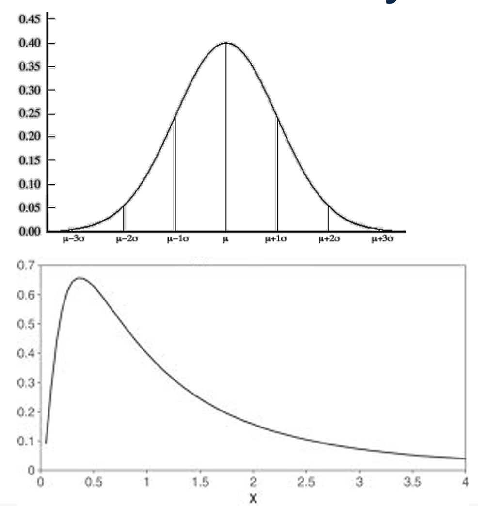
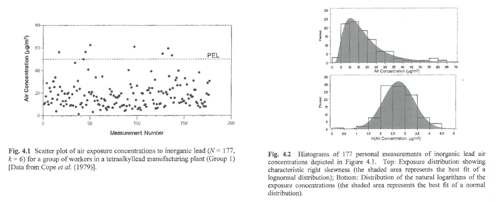
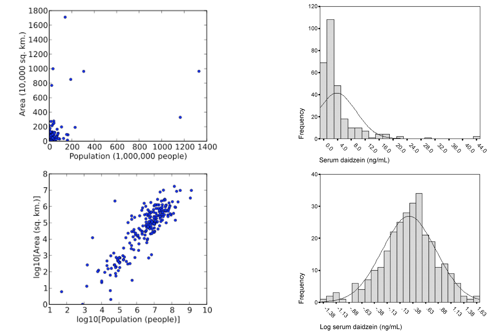
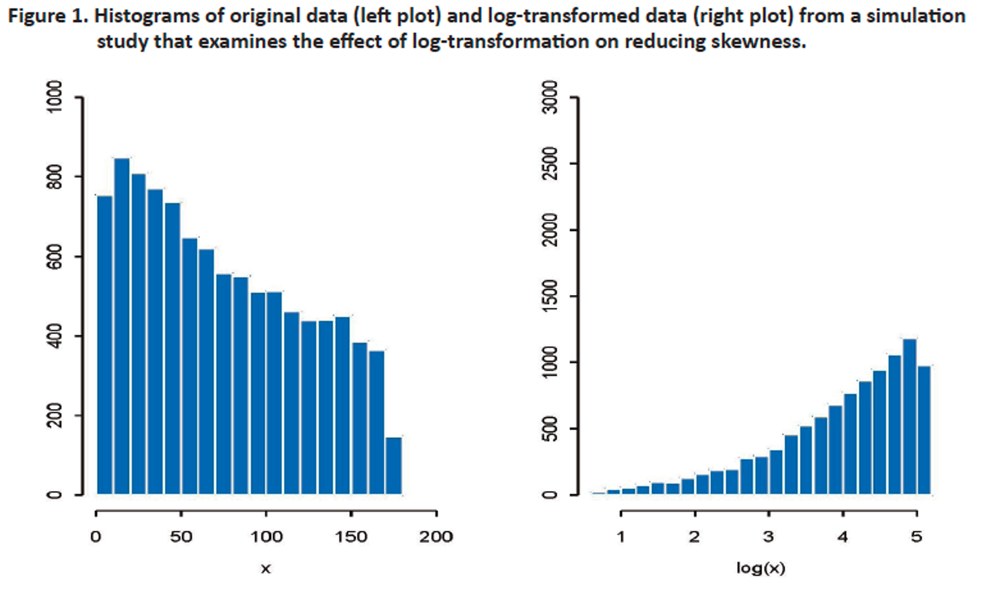
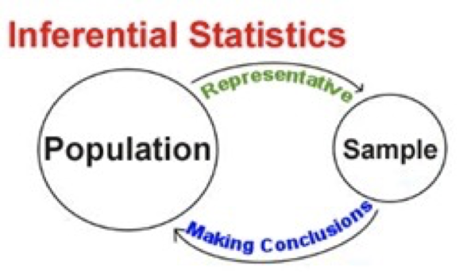
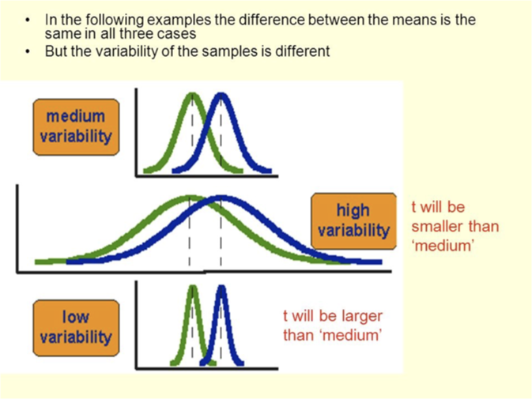
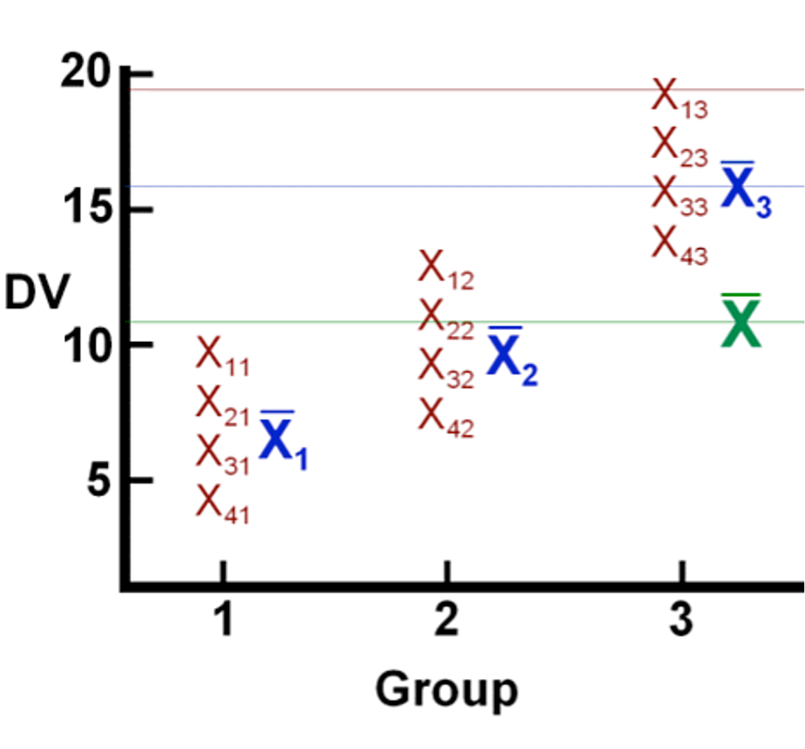
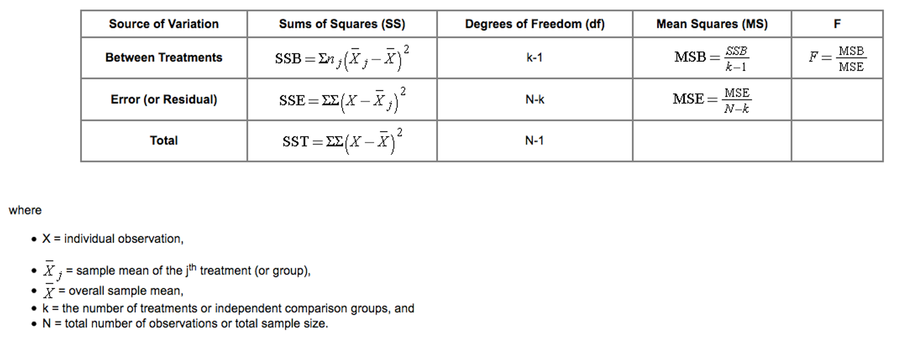
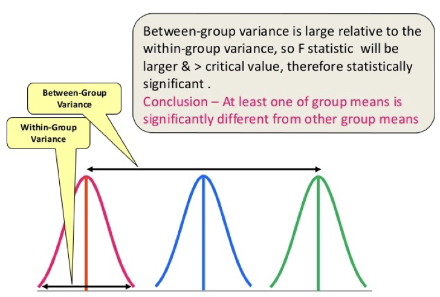
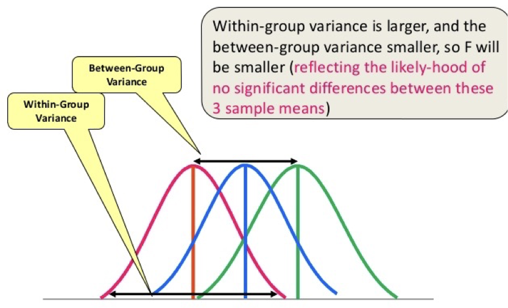

::: {.content-visible when-format="revealjs"}

------------------------------------------------------------------------

## Lecture 11: Transformations, inferential statistics (t-test, ANOVA)

------------------------------------------------------------------------
:::

::: {.content-hidden when-format="revealjs"}
```{r, message=FALSE, warning=FALSE}
#| code-fold: true
#| code-summary: "Click to view catchup R code"

# set your working directory with `setwd()`!!

# load packages we need
library(tidyverse) # data manipulation and plotting
library(readxl) # reading in our excel dataset
library(janitor) # cleaning columns names and more

# set the theme of all ggplots to `theme_minimal()`
theme_set(theme_minimal())

# read dataset excel file and make sure it's a tibble
ehs655 <- read_xlsx("Dataset V1.xlsx") %>% as_tibble()

# make all column names lowercase and snake_case
ehs655 <- ehs655 %>% clean_names()

# clean job title variable to remove misspellings
ehs655 <- ehs655 %>%
  mutate(
    job_title = 
      case_when(
        job_title == "Lborer" ~ "Laborer",
        job_title == "Laboerr" ~ "Laborer",
        job_title == "Electrican" ~ "Electrician",
        job_title == "Carpentr" ~ "Carpenter",
        job_title == "Operaing engineer" ~ "Operating engineer",
        job_title == "Ironworkr" ~ "Ironworker",
        job_title == "" ~ NA,
        .default = job_title))

# clean gender variable to fix multiple classification schemes
ehs655 <- ehs655 %>%
  mutate(
    gender = 
      case_when(
        gender == "M" ~ "Male",
        gender == "F" ~ "Female",
        .default = gender))

# convert LEQ values <LOD to LOD/sqrt(2)
ehs655 <- ehs655 %>%
  mutate(work_leq_d_ba = ifelse(work_leq_d_ba < 70, 70/sqrt(2), work_leq_d_ba))

# estimate time-weighted averages for each shift
ehs655 <- ehs655 %>%
  mutate(TWA = work_leq_d_ba + 10*log10(measured_shift_length_mins/480))

# estimate peakiness for each shift
ehs655 <- ehs655 %>%
  mutate(peakiness = lmax_d_ba_shift/work_leq_d_ba)

# dropping bad cases of TWA and Lmax based on calibration
ehs655 <- ehs655 %>%
  mutate(TWA = ifelse(post_cal_value_d_ba < 113.5 | 
                        post_cal_value_d_ba > 114.5,
                      NA,
                      TWA)) %>%
  mutate(lmax_d_ba_shift = ifelse(is.na(TWA),
                                  NA,
                                  lmax_d_ba_shift))

# keeping only good cases of 70 <= Lmax <= 140 dBA based on physical bounds
ehs655 <- ehs655 %>%
  mutate(lmax_d_ba_shift = ifelse(lmax_d_ba_shift < 70,
                                  70,
                                  lmax_d_ba_shift)) %>%
  mutate(lmax_d_ba_shift = ifelse(lmax_d_ba_shift > 140,
                                  140,
                                  lmax_d_ba_shift))
```
:::

### What we'll cover today

- Transformations

- Inferential statistics

  - t-test

  - ANOVA

------------------------------------------------------------------------

### Transforming variables

- Many inferential statistical methods assume data are normally distributed

  - t-test

  - ANOVA

  - Linear regression

- However, many exposures positive and right-skewed

  {width="50%"}

------------------------------------------------------------------------

### One solution: log-transform data

$Y_i = \text{ln}(x_i)$

where

- $Y_i$ is log-transformed data point

- $x_i$ is original data point

- $\text{ln}$ is natural logarithm function

Natural log (ln) transform of lognormally distributed variable has properties of normal distribution

- i.e., bell-shaped and symmetric

Described by geometric mean (GM) and geometric standard deviation (GSD)

------------------------------------------------------------------------

### Log transformation notes

- Can only be used for positive values

  - Common practice to add a small positive constant, M, to all observations before applying transformation (examples: 0.001 or 1)

  - Although this seems harmless, can have a noticeable effect on level of statistical significance in hypothesis testing

- No guarantee log transformation will reduce skewness

- Despite conventional wisdom, analysis on log transformed data may not address outliers better than original data

::: custom-footer
<https://www.ncbi.nlm.nih.gov/pmc/articles/PMC4120293/>
:::

------------------------------------------------------------------------

### Example of effective log transformation

Exposure distributions - original and transformed

{width="90%"}

::: custom-footer
Rappaport and Kupper, 2008
:::

------------------------------------------------------------------------

### Example of effective log transformation

{width="85%"}

------------------------------------------------------------------------

### Example of ineffective log transformation

{width="90%"}

::: custom-footer
<https://www.ncbi.nlm.nih.gov/pmc/articles/PMC4120293/>
:::

------------------------------------------------------------------------

### Evaluating lognormal distribution

Quantile-quantile plots

```{r, eval=FALSE}
# sample R code
df %>%
  ggplot(aes(sample = x)) +
  stat_qq() +
  stat_qq_line(color = "blue") +
  labs(
    title = "Normal Q-Q Plot",
    x = "Theoretical Quantiles",
    y = "Sample Quantiles"
  )
```

------------------------------------------------------------------------

### Interpreting log transformed estimates

Arithmetic mean of log transformed exposures: $\bar{y}$

Arithmetic SD of log transformed exposures: $\Theta_y$

Geometric mean (antilog of mean of log-transformed exposures): $GM = e^{\bar{y}}$

Geometric standard deviation: $GSD = e^{\Theta_y}$

------------------------------------------------------------------------

### Caution about transformation

- Back-transformed mean ≠ original variable mean

  - GM isn't easily interpreted

- Proper to run statistical tests on transformed values

  - But often report means in unit of untransformed scale as well

- “If it ain’t broke, don’t fix it.” Transformation bad if:

  - Distribution more or less symmetrical, few outliers

  - Variances reasonably homogeneous

- Transformation may be useful – more to come

  - Markedly skewed data or heterogeneous variances

------------------------------------------------------------------------

### Inferential statistics

- Descriptive statistics applied to populations are called parameters

- Inferential statistics apply to samples

- We’ll focus on two inferential approaches today

  - t-test

  - ANOVA

{width="40%"}

------------------------------------------------------------------------

### t-test

{width="80%"}

------------------------------------------------------------------------

### t-test

- Detect differences between means of (normally-distributed) samples

  - Significant t-statistic = means differ

- Student’s (unpaired) t-test

  - Test hypothesis that means of two samples are equal; null is

    $$
    \bar{x}_1=\bar{x}_2
    $$

- Paired sample t-test

  - Test whether two measurements on same individual are equal

------------------------------------------------------------------------

### Things we can do with a t-test

- Single-sample t-test

  - Identify differences in the mean of a group and a reference value

- Unpaired t-test

  - Identify differences in mean exposures between two groups

- Paired-sample t-test

  - Identify differences in exposure before and after an intervention in a group of subjects

------------------------------------------------------------------------

### ANOVA (ANalysis Of VAriance)

- Technique for assessing how categorical independent variables affect [**continuous**]{.underline} dependent variable

- Like a t-test generalized to three or more means

  - Tells use whether means from k groups are same or not

- Null hypothesis:

$$
\bar{x}_1=\bar{x}_2=\bar{x}_3=...=\bar{x}_n
$$

------------------------------------------------------------------------

### Things we can do with ANOVA

- Identify differences in mean exposures between more than two groups

  - Within-group \> between group = [poor]{style="color: red;"} exposure grouping

  - Within-group \< between group = [good]{style="color: green;"} exposure grouping

- Evaluate relationship of within-worker variance within exposure group to between-worker variance

  - Within-worker \> between worker = [good]{style="color: green;"} exposure grouping

  - Within-worker \< between worker = [poor]{style="color: red;"} exposure grouping

------------------------------------------------------------------------

### ANOVA assumptions

- Continuous dependent variable

- Independent variable is 2+ categorical groups

- Data independent from each other

- Errors normally distributed

- Variances same for all groups

- ANOVA fairly robust for these assumptions

  - But data should not be extremely far off

------------------------------------------------------------------------

### ANOVA illustrated

{width="75%"}

------------------------------------------------------------------------

### Generic ANOVA components

{width="95%"}

------------------------------------------------------------------------

### ANOVA - F-test

- Compares variability in exposure accounted for by predictor variable vs error variability

- Error variability (mean squared error) measures inherent randomness of observations

- Large differences between groups = significant F test

$$
F=\frac{MS_{Between}}{MS_{Within}}
$$

------------------------------------------------------------------------

### F-statistic

{width="85%"}

------------------------------------------------------------------------

### F-statistic

{width="90%"}

------------------------------------------------------------------------

### R ANOVA output

```{r}
# run anova
anova_model <- aov(TWA~job_title, data = ehs655)

# print summary of anova
summary(anova_model)
```

[**Bigger F = significant**]{style="color: red;"}

------------------------------------------------------------------------

### Why use ANOVA instead of t-test?

- Could do t-tests for all pairs of predictor variable categories

- Not a good idea

  - As number of exposure groups grows, so does number of needed pair comparisons

  - Each comparison introduces risk of error

- ANOVA puts all data into one number (F) and gives one P for null hypothesis

------------------------------------------------------------------------

### ANOVA in action

Enough with words already. Let’s see how ANOVA actually works

<https://demonstrations.wolfram.com/VisualANOVA/>

------------------------------------------------------------------------

### t-test

Detect differences between means of (normally-distributed) samples

- Significant t-statistic = means differ

Student’s (unpaired) t-test

- Test hypothesis that means of two samples are equal; null is

  ```{r, eval=FALSE}
  t.test(varname1~groupvar, data = dataset1)
  ```

Paired sample t-test

- Test whether two measurements on same individual are equal

  ```{r, eval=FALSE}
  t.test(dataset1$varname1, dataset2$varname2, paired = TRUE)
  ```

------------------------------------------------------------------------

### Interpreting single-sample t-test in R

Is the average TWA in our dataset significantly different from the 85 dBA REL?

```{r}
t.test(ehs655$TWA, mu = 85)
```

------------------------------------------------------------------------

### Interpreting t-test between groups in R

Does the average TWA in our dataset differ significantly by gender?

```{r}
t.test(TWA~gender, data = ehs655)
```

------------------------------------------------------------------------

### Interpreting paired t-test in R

Does the average TWA in our dataset differ before and after some random date (say 2010)?

```{r}
ehs655 <- ehs655 %>% mutate(
  prepost2010 = 
    ifelse(
      measurement_date >= "2010-01-01",
      "pre2010",
      "post2010"
      )
  )

t.test(TWA~prepost2010, data = ehs655)
```
