::: {.content-visible when-format="revealjs"}

------------------------------------------------------------------------

## Lecture 12: Inferential statistics (linear regression)

------------------------------------------------------------------------
:::

::: {.content-hidden when-format="revealjs"}
```{r, message=FALSE, warning=FALSE}
#| code-fold: true
#| code-summary: "Click to view catchup R code"

# set your working directory with `setwd()`!!

# load packages we need
library(tidyverse) # data manipulation and plotting
library(readxl) # reading in our excel dataset
library(janitor) # cleaning columns names and more

# set the theme of all ggplots to `theme_minimal()`
theme_set(theme_minimal())

# read dataset excel file and make sure it's a tibble
ehs655 <- read_xlsx("Dataset V1.xlsx") %>% as_tibble()

# make all column names lowercase and snake_case
ehs655 <- ehs655 %>% clean_names()

# clean job title variable to remove misspellings
ehs655 <- ehs655 %>%
  mutate(
    job_title = 
      case_when(
        job_title == "Lborer" ~ "Laborer",
        job_title == "Laboerr" ~ "Laborer",
        job_title == "Electrican" ~ "Electrician",
        job_title == "Carpentr" ~ "Carpenter",
        job_title == "Operaing engineer" ~ "Operating engineer",
        job_title == "Ironworkr" ~ "Ironworker",
        job_title == "" ~ NA,
        .default = job_title))

# clean gender variable to fix multiple classification schemes
ehs655 <- ehs655 %>%
  mutate(
    gender = 
      case_when(
        gender == "M" ~ "Male",
        gender == "F" ~ "Female",
        .default = gender))

# convert LEQ values <LOD to LOD/sqrt(2)
ehs655 <- ehs655 %>%
  mutate(work_leq_d_ba = ifelse(work_leq_d_ba < 70, 70/sqrt(2), work_leq_d_ba))

# estimate time-weighted averages for each shift
ehs655 <- ehs655 %>%
  mutate(TWA = work_leq_d_ba + 10*log10(measured_shift_length_mins/480))

# estimate peakiness for each shift
ehs655 <- ehs655 %>%
  mutate(peakiness = lmax_d_ba_shift/work_leq_d_ba)

# dropping bad cases of TWA and Lmax based on calibration
ehs655 <- ehs655 %>%
  mutate(TWA = ifelse(post_cal_value_d_ba < 113.5 | 
                        post_cal_value_d_ba > 114.5,
                      NA,
                      TWA)) %>%
  mutate(lmax_d_ba_shift = ifelse(is.na(TWA),
                                  NA,
                                  lmax_d_ba_shift))

# keeping only good cases of 70 <= Lmax <= 140 dBA based on physical bounds
ehs655 <- ehs655 %>%
  mutate(lmax_d_ba_shift = ifelse(lmax_d_ba_shift < 70,
                                  70,
                                  lmax_d_ba_shift)) %>%
  mutate(lmax_d_ba_shift = ifelse(lmax_d_ba_shift > 140,
                                  140,
                                  lmax_d_ba_shift))
```
:::

### What we'll cover today

Linear regression

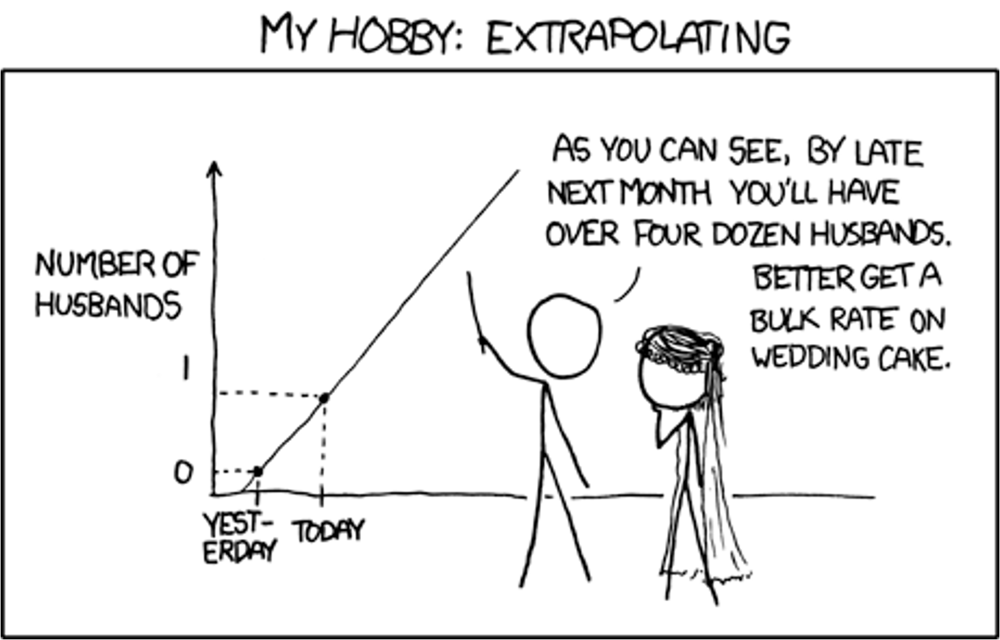{width="70%"}

------------------------------------------------------------------------

### Linear regression

Simple linear regression [**estimates straight line**]{.underline}

$$
\hat{Y}=\beta_0+\beta_1 X_1
$$

Where

- $\hat{Y}$ is predicted value of response variable $Y_i$ for given value of predictor variable $X$

- $\beta_0$ is intercept (value of response at predictor = 0)

- $\beta_1$ is slope (average change in response for unit change in predictor variable)

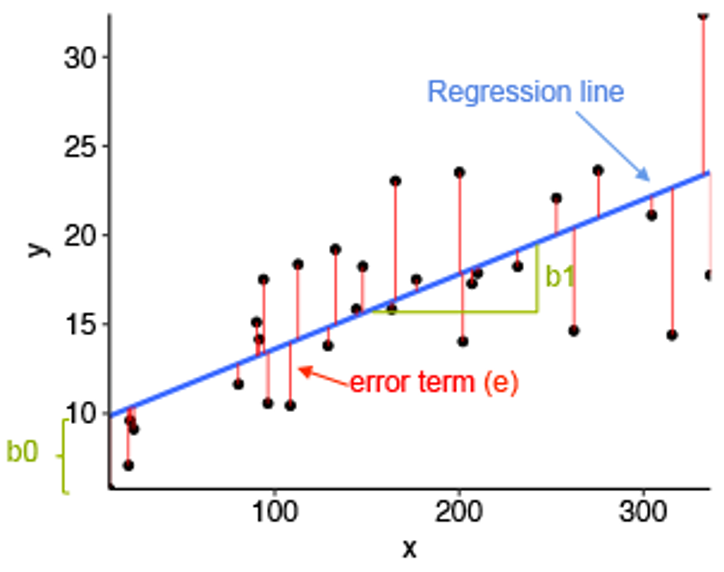{width="40%"}

------------------------------------------------------------------------

### Things we can do with regression

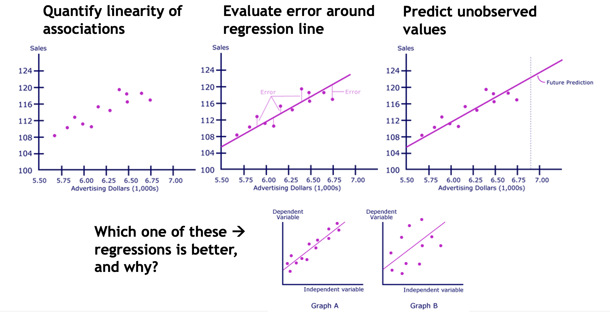{width="90%"}

------------------------------------------------------------------------

### Regression

- Closely related to ANOVA

  - Both provide point estimates for parameters that describe mean exposure under given set of conditions

- Differences

  - In ANOVA, all independent variables treated as categorical

  - In regression, mixture of data types allowed (!)

------------------------------------------------------------------------

### Regression assumptions

- Continuous dependent variable

- Continuous or categorical indep variable

- Linearity

- Normality (or large n)

- Equal variance within groups

  - (Assumptions relaxed with robust regression)

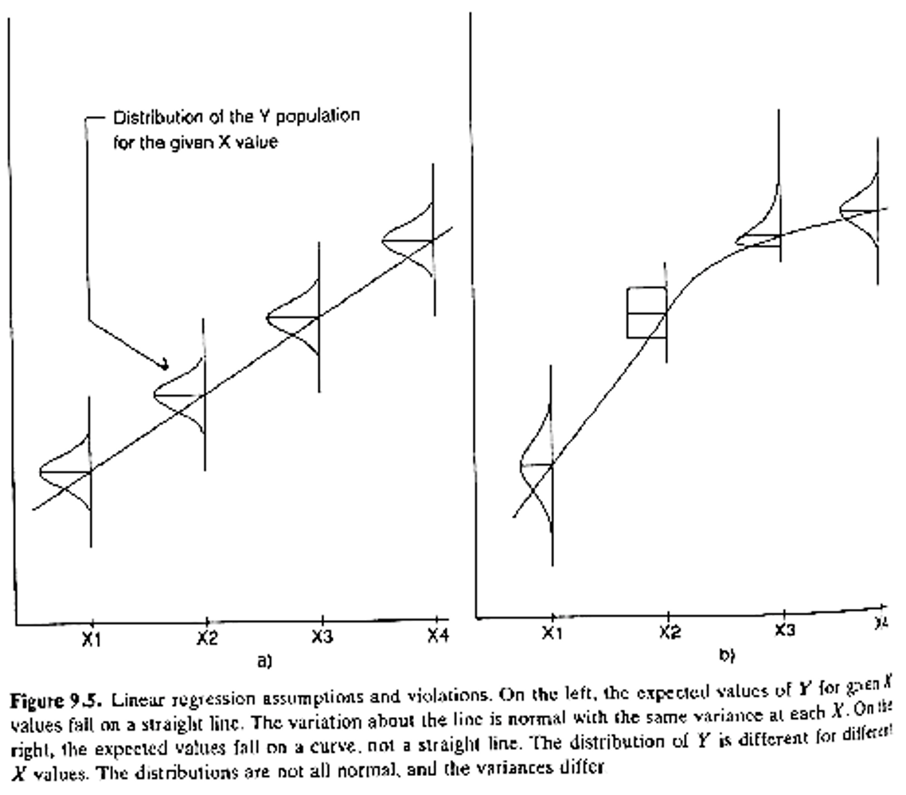{width="75%"}

------------------------------------------------------------------------

### Regression assumptions

Equal variance across range of data (homoscedasticity)

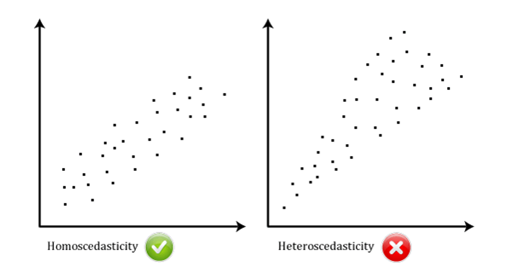{width="85%"}

------------------------------------------------------------------------

### Regression assumptions

No significant outliers

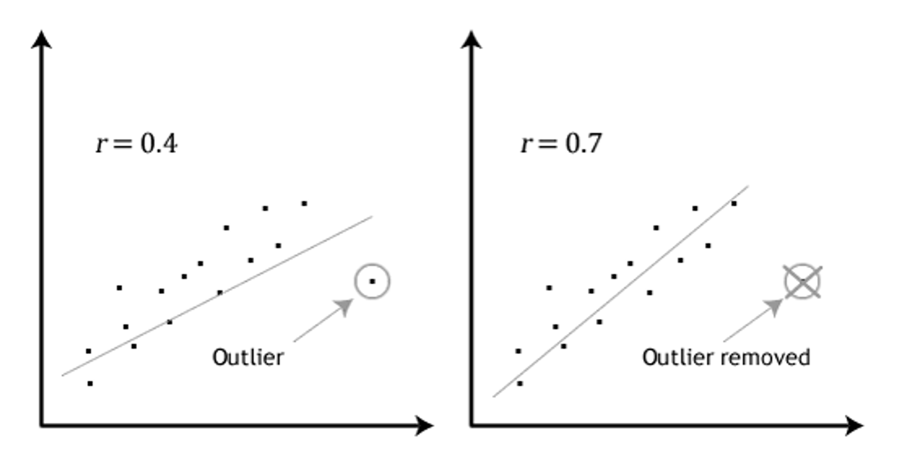{width="85%"}

------------------------------------------------------------------------

### Least squares regression

Residual is distance from each point to fitted line

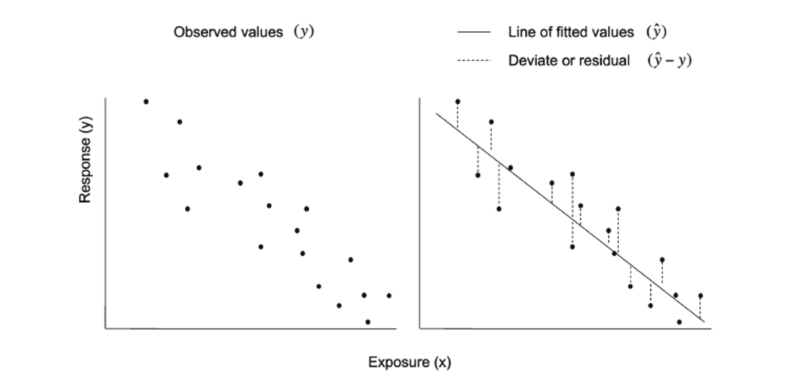{width="80%"}

::: custom-footer
Ravani, Barrett, Parfrey, 2009
:::

------------------------------------------------------------------------

### Least squares regression

- “Best” estimate for line is one that minimizes sum of squared residuals

- Where

  - $SS_{res}$ is squared sum of residuals between observed values of $Y$ and values of $\hat{Y}$ predicted from regression equation

$$
SS_{res}=\Sigma[Y-\hat{Y}]^2
$$

------------------------------------------------------------------------

### Least squares

- Null hypothesis in linear regression: $b$ (slope) = 0

- To test this, program computes ratio of magnitude of slope to precision with which it is estimated (standard error)

$$
t_{b_1}=\frac{b_1}{se_{b_1}}
$$

- Large $t_b$ shows significant relationship

------------------------------------------------------------------------

### Multivariable linear regression

Multiple predictor variables

$$
\hat{Y} = \beta_0 + \beta_1 X_1 + \beta_2 X_2
$$

Where

- $\beta_1$ quantifies sensitivity of $Y$ to change to $X_1$, adjusting for effect of $X_2$ of $Y$

- $\beta_2$ quantifies sensitivity of $Y$ to change to $X_2$, adjusting for effect of $X_1$ of $Y$

------------------------------------------------------------------------

### Variable selection in regression

- Forward selection

  - Add variables sequentially, starting from nothing

- Backward selection

  - Subtract variables sequentially, starting with all potential variables

- Forward stepwise selection

  - Add variables sequentially, starting from nothing

  - Backward selection each time new variable entered to see if any added previously can be dropped

  - Multicollinearity creates big problems

------------------------------------------------------------------------

### Repeated measurements need special consideration

- Failing to account for repeated measurements = positive slope

- Accounting for repeated measurements = negative slope

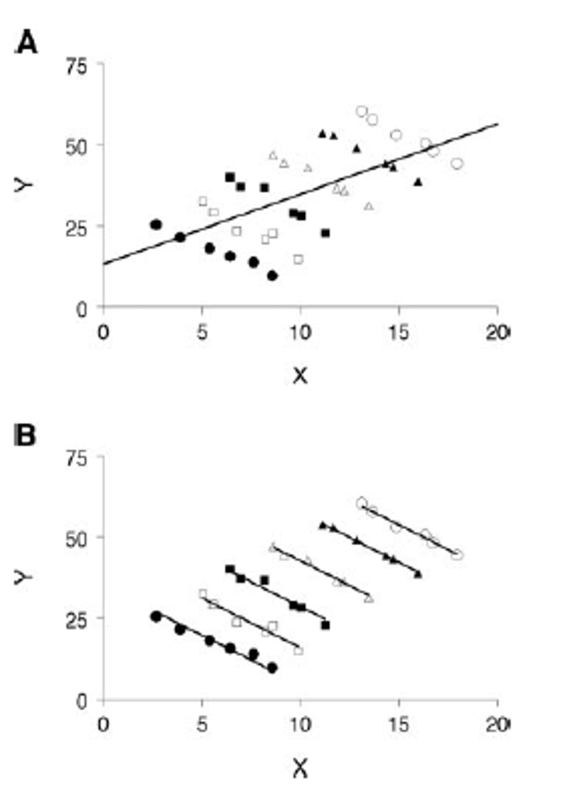{width="50%"}

------------------------------------------------------------------------

### Linear regression with repeated measurement

- Use mixed effects model

  - “Mixed” = random + fixed effects

  - Treat each subject as random sample of population of interest

  - Allows us to account for within-subject variability

- Will cover this topic (much) more in subsequent lectures

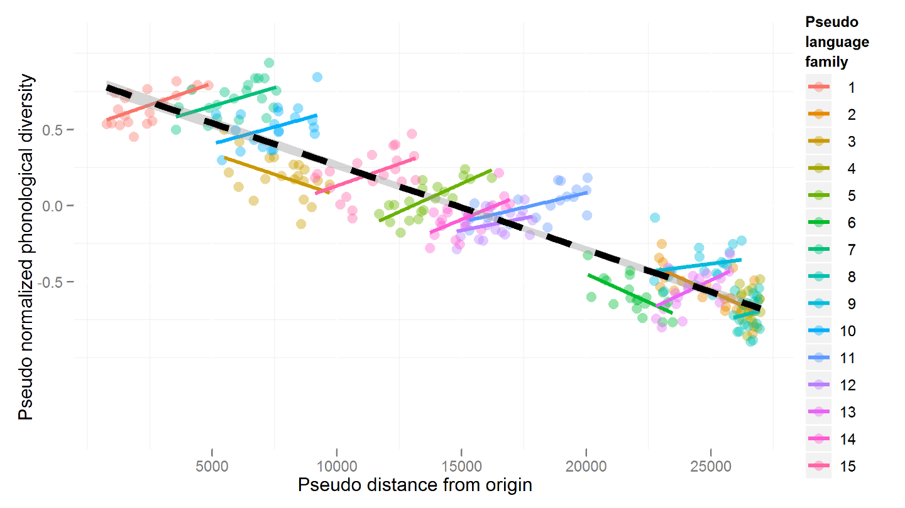{width="60%"}

------------------------------------------------------------------------

### Coefficient of determination ($R^2$)

- Proportion of variance explained by line

  - Often used as measure of model fit

  - Higher $R^2$ means better fit of line

  - Interpreting $R^2=X$ explains n% of variance in $Y$

- Influenced by

  - Outliers

  - $N$ (sample size)

  - Non-linear trends in data

- Always increases as you add more predictors

  - Adjusted $R^2$ accounts for number of predictors, sample size

------------------------------------------------------------------------

### $R^2$

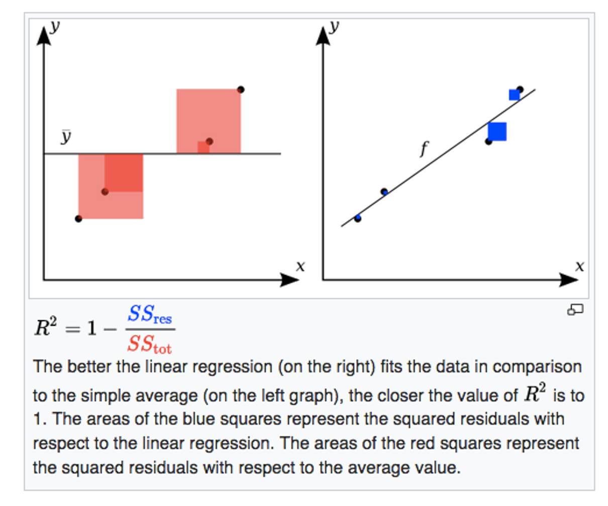{width="70%"}

------------------------------------------------------------------------

### Cautionary notes about regression

- Lack of a significant slope estimate can mean

  - No association

  - Association exists, but not in parameters considered

  - Association exists, but best fitting line has zero slope

  - Association exists but we didn’t have power to detect it

- $R^2$ doesn’t tell you if

  - independent variables cause changes in dependent variable

  - the correct regression was used

  - the independent variables chosen are most appropriate

  - there is collinearity present independent variables

  - there are enough data points to make a solid conclusion

------------------------------------------------------------------------

### Cautionary notes about regression

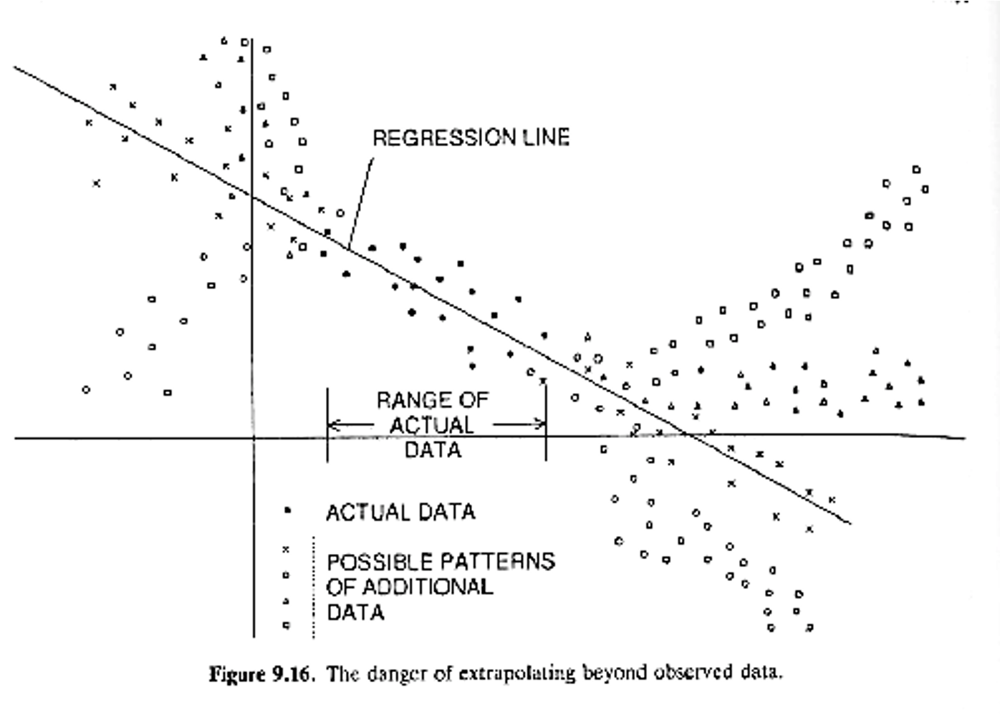{width="75%"}

------------------------------------------------------------------------

### Example cautionary note about regression

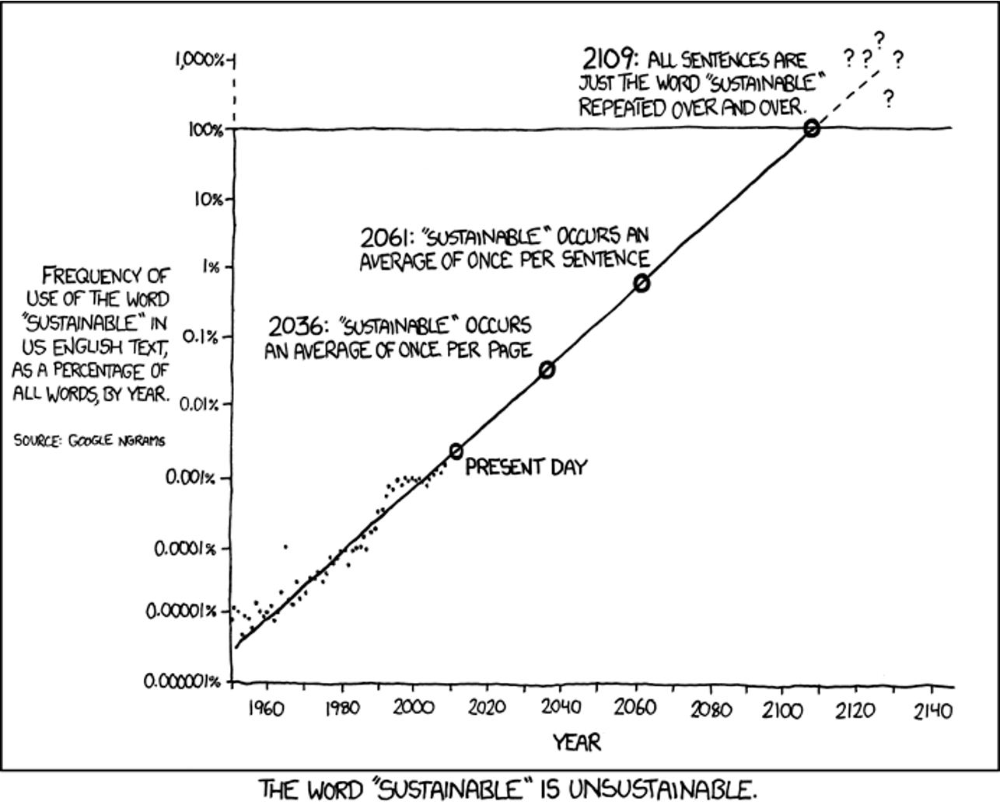{width="75%"}

------------------------------------------------------------------------

### Demonstration

Enough talk - let's look at a demo:

<http://www.shodor.org/interactivate/activities/Regression/>

------------------------------------------------------------------------

### Example R linear regression output

```{r}
mod1 <- ehs655 %>% lm(peakiness ~ TWA, data = .)
summary(mod1)
```

Interpretation: for every 1 dBA change in TWA, -0.02 dBA change in peakiness

------------------------------------------------------------------------

### Notes on how to specify variables appropriately

- If the variable is continuous and coded as numeric

  - R will assume it's continuous

- If the variable is categorical but it is coded as numeric

  - R will assume it's continuous

  - E.g., Likert score of 1-5 needs to be converted to character or factor first

- If the variable is categorical and is coded as character or factor

  - R will assume it's categorical

  - It will automatically drop the first level in the variable and use it as the reference level

  - To control the reference level, use `factor(var, levels = c("level1", "level2", ..., "levelN")`

------------------------------------------------------------------------

### Example

::::: columns-only-on-slides
::: slide-column
If we regress job title on TWA, R will recognize it is a character and treat it as a categorical variable

```{r}
ehs655 %>% lm(TWA ~ job_title, data = .) %>% summary()
```

BUT, it will automatically drop carpenters since it is alphabetically first.
:::

::: slide-column
If we want to specify another job title as the reference (say electrician), we need to create a factor variable first and specify the levels

```{r}
ehs655 %>%
  mutate(job_title = 
           factor(job_title, 
                  levels = c("Electrician", "Carpenter", "Laborer", "Operating engineer", "Ironworker"))
         ) %>%
  lm(TWA ~ job_title, data = .) %>%
  summary()
```
:::
:::::

------------------------------------------------------------------------

### Example R multiple linear regression output

```{r}
ehs655 %>%
  lm(TWA ~ gender + age_baseline_years + job_title,
     data = .) %>%
  summary()
```

For every 1 year change in age at baseline, there is a -0.31 dBA change in TWA, controlling for gender and job title
