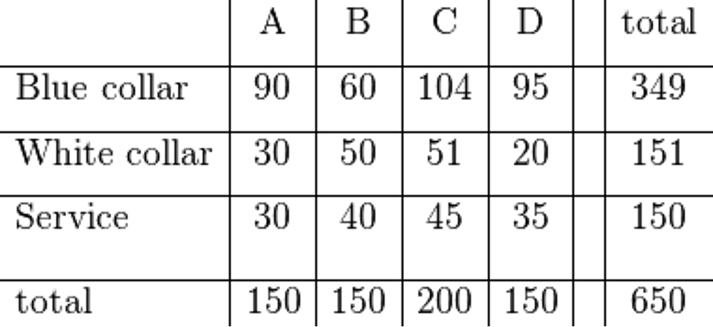
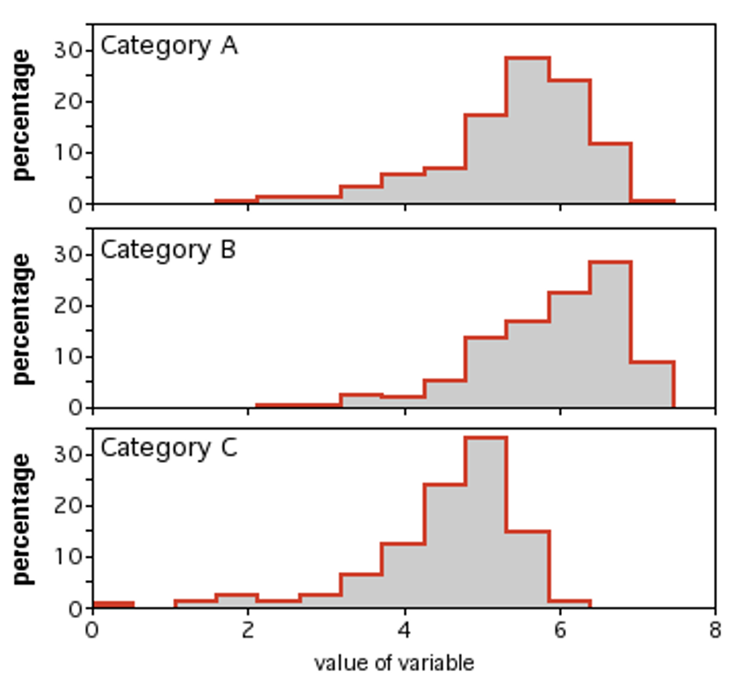

::: {.content-visible when-format="revealjs"}

------------------------------------------------------------------------

## Lecture 14: Exposure modeling - categorical analysis

------------------------------------------------------------------------
:::

::: {.content-hidden when-format="revealjs"}
```{r, message=FALSE, warning=FALSE}
#| code-fold: true
#| code-summary: "Click to view catchup R code"

# set your working directory with `setwd()`!!

# load packages we need
library(tidyverse) # data manipulation and plotting
library(readxl) # reading in our excel dataset
library(janitor) # cleaning columns names and more

# set the theme of all ggplots to `theme_minimal()`
theme_set(theme_minimal())

# read dataset excel file and make sure it's a tibble
ehs655 <- read_xlsx("Dataset V1.xlsx") %>% as_tibble()

# make all column names lowercase and snake_case
ehs655 <- ehs655 %>% clean_names()

# clean job title variable to remove misspellings
ehs655 <- ehs655 %>%
  mutate(
    job_title = 
      case_when(
        job_title == "Lborer" ~ "Laborer",
        job_title == "Laboerr" ~ "Laborer",
        job_title == "Electrican" ~ "Electrician",
        job_title == "Carpentr" ~ "Carpenter",
        job_title == "Operaing engineer" ~ "Operating engineer",
        job_title == "Ironworkr" ~ "Ironworker",
        job_title == "" ~ NA,
        .default = job_title))

# clean gender variable to fix multiple classification schemes
ehs655 <- ehs655 %>%
  mutate(
    gender = 
      case_when(
        gender == "M" ~ "Male",
        gender == "F" ~ "Female",
        .default = gender))

# convert LEQ values <LOD to LOD/sqrt(2)
ehs655 <- ehs655 %>%
  mutate(work_leq_d_ba = ifelse(work_leq_d_ba < 70, 70/sqrt(2), work_leq_d_ba))

# estimate time-weighted averages for each shift
ehs655 <- ehs655 %>%
  mutate(TWA = work_leq_d_ba + 10*log10(measured_shift_length_mins/480))

# estimate peakiness for each shift
ehs655 <- ehs655 %>%
  mutate(peakiness = lmax_d_ba_shift/work_leq_d_ba)

# dropping bad cases of TWA and Lmax based on calibration
ehs655 <- ehs655 %>%
  mutate(TWA = ifelse(post_cal_value_d_ba < 113.5 | 
                        post_cal_value_d_ba > 114.5,
                      NA,
                      TWA)) %>%
  mutate(lmax_d_ba_shift = ifelse(is.na(TWA),
                                  NA,
                                  lmax_d_ba_shift))

# keeping only good cases of 70 <= Lmax <= 140 dBA based on physical bounds
ehs655 <- ehs655 %>%
  mutate(lmax_d_ba_shift = ifelse(lmax_d_ba_shift < 70,
                                  70,
                                  lmax_d_ba_shift)) %>%
  mutate(lmax_d_ba_shift = ifelse(lmax_d_ba_shift > 140,
                                  140,
                                  lmax_d_ba_shift))
```
:::

### Review: uses of ANOVA and linear regression

- ANOVA

  - Ordinal or nominal independent variables effects on continuous dependent variable

  - Comparison of group means

  - Example: exposure level by job title

- Linear regression accomplishes the same

  - But can use nominal, ordinal, or continuous independent variables

  - Example: exposure level by date

------------------------------------------------------------------------

### What we'll cover today

- Computing hours worked per year by each participant

- Categorical analyses

- Midterm report review

- Assignment 3

------------------------------------------------------------------------

### Computing hours worked per year for each participant

We can estimate the number of hours each participant worked per year by combining data from the following variables

```{r}
ehs655 <- ehs655 %>%
  mutate(hours_worked_per_year =
           usual_shift_length_hours*usual_hours_worked_per_week*usual_weeks_worked_per_year)

# check out the data generated
ehs655 %>% pull(hours_worked_per_year) %>% summary()
```

------------------------------------------------------------------------

### Perceived exposure variables

::::: columns-only-on-slides
::: slide-column
- Variables we haven’t considered based on worker perceptions

  - `perceived_noise_level_shift`

  - `perceived_type_of_noise_shift`

  - `other_nearby_noise_shift`

- Note that rank ordering alphabetically != rank ordering of perception for perceived_noise_level_shift

  - Alphabetical order = high, low, medium

  - Perceived order = low, medium, high

- How to reconcile?
:::

::: slide-column
```{r}
# check order of variable before cleaning
ehs655 %>% pull(perceived_noise_level_shift) %>% unique() %>% sort()

ehs655 <- ehs655 %>%
  mutate(perceived_noise_level_shift =
           factor(perceived_noise_level_shift,
                  levels = c("Low", "Moderate", "High")))

# check order of variable after cleaning
ehs655 %>% pull(perceived_noise_level_shift) %>% unique() %>% sort()
```
:::
:::::

------------------------------------------------------------------------

### Analyzing categorical variables

- What about categorical variables?

- Use nonparametric tests that do not assume normality (but still assume independence)

  - Lose some statistical power as assumptions relaxed

  - Nonparametric tests typically more robust to presence of outliers

------------------------------------------------------------------------

### Chi-square test: independent groups

- Use to evaluate relationship between variables with ≥2 categories (i.e., n x n table)

  - Evaluates difference between observed frequencies and those expected if variables independent (i.e. relative risk of 1)

  - Assumes cell counts (frequencies) \>5

- Significant result = [**reject null hypothesis**]{.underline}; variables are associated (i.e., [**are related to each other**]{.underline})

- Example: perceived exposure type by job title

  ```{r}
  # make n x n table first then run chi-squared test
  ehs655 %>%
    tabyl(job_title, perceived_noise_level_shift) %>%
    chisq.test()
  ```

{width="40%"}

------------------------------------------------------------------------

### Kruskal-Wallis rank (H) test

- Use to evaluate ordinal or continuous dependent and nominal independent variables with 2 or more levels

  - Non-parametric version of one-way ANOVA

- Significant result = [**reject nullhypothesis**]{.underline}; distribution of at least [**one category different than others**]{.underline}

  - Like ANOVA, doesn’t say where/how many differences occur

- Example: perceived noise by job

  ```{r}
  # note different syntax for different test
  # don't need to make n x n table
  ehs655 %>% kruskal.test(perceived_noise_level_shift ~ job_title, data = .)
  ```

{width="40%"}
