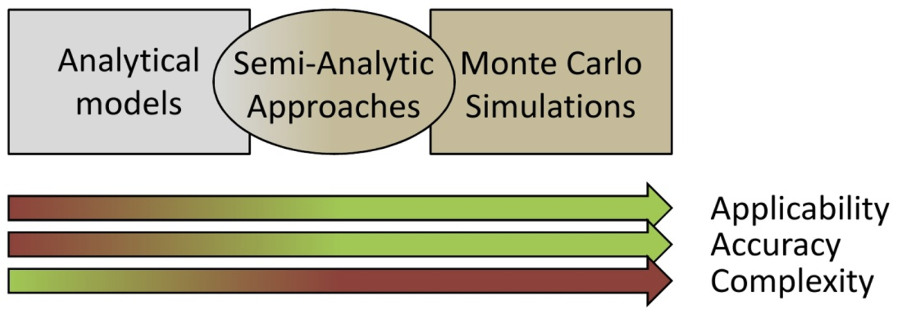
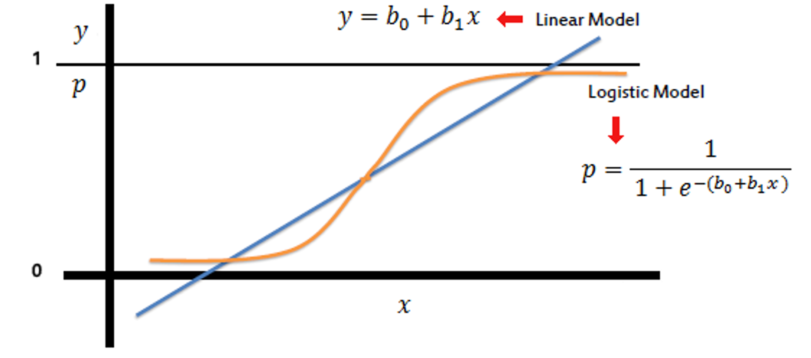
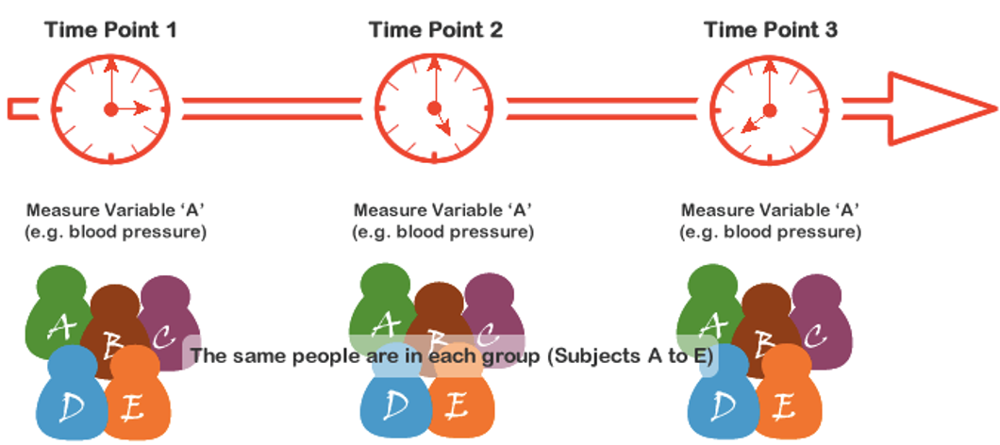
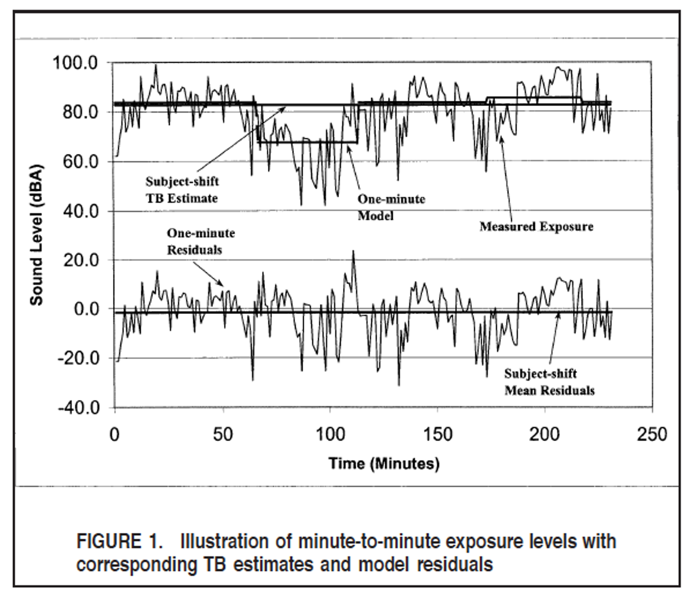
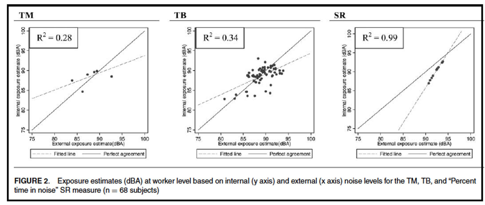
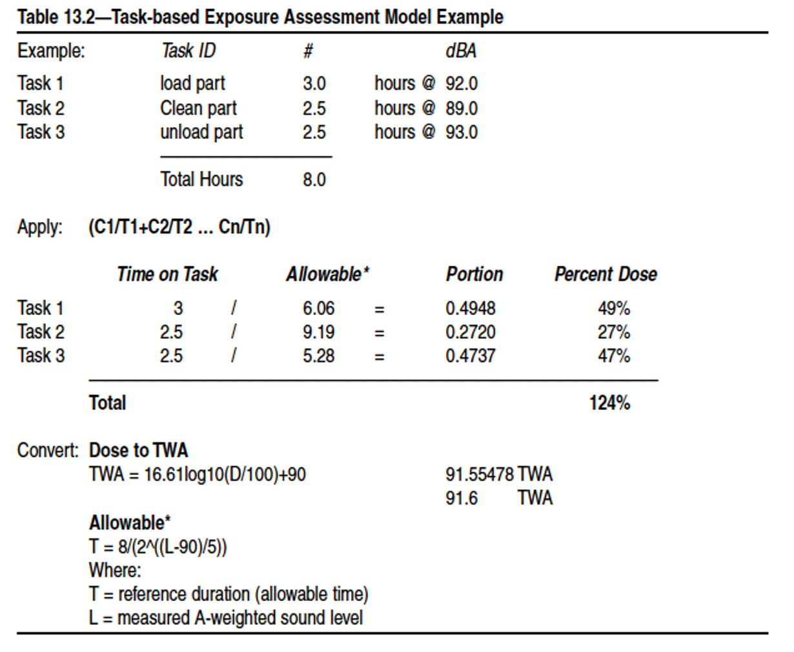

::: {.content-visible when-format="revealjs"}

------------------------------------------------------------------------

## Lecture 15: Linear and logistic regression, task-based assessment

------------------------------------------------------------------------
:::

We are working with a new dataset today (`Dataset V2.xlsx`). Make sure to download it from the Canvas page.

The V2 dataset has the same columns as before, but now has repeated samples for each participant.

::: {.content-hidden when-format="revealjs"}
```{r, message=FALSE, warning=FALSE}
#| code-fold: false
#| code-summary: "Click to view catchup R code"

# set your working directory with `setwd()`!!

# load packages we need
library(tidyverse) # data manipulation and plotting
library(readxl) # reading in our excel dataset
library(janitor) # cleaning columns names and more

# set the theme of all ggplots to `theme_minimal()`
theme_set(theme_minimal())

# read dataset excel file and make sure it's a tibble
#### note new dataset file name
ehs655_v2 <- read_xlsx("Dataset V2.xlsx") %>% as_tibble()

# make all column names lowercase and snake_case
ehs655_v2 <- ehs655_v2 %>% clean_names()

# clean job title variable to remove misspellings
ehs655_v2 <- ehs655_v2 %>%
  mutate(
    job_title = 
      case_when(
        job_title == "Lborer" ~ "Laborer",
        job_title == "Laboerr" ~ "Laborer",
        job_title == "Electrican" ~ "Electrician",
        job_title == "Carpentr" ~ "Carpenter",
        job_title == "Operaing engineer" ~ "Operating engineer",
        job_title == "Ironworkr" ~ "Ironworker",
        job_title == "" ~ NA,
        .default = job_title))

# clean gender variable to fix multiple classification schemes
ehs655_v2 <- ehs655_v2 %>%
  mutate(
    gender = 
      case_when(
        gender == "M" ~ "Male",
        gender == "F" ~ "Female",
        .default = gender))

# convert LEQ values <LOD to LOD/sqrt(2)
ehs655_v2 <- ehs655_v2 %>%
  mutate(work_leq_d_ba = ifelse(work_leq_d_ba < 70, 70/sqrt(2), work_leq_d_ba))

# estimate time-weighted averages for each shift
ehs655_v2 <- ehs655_v2 %>%
  mutate(TWA = work_leq_d_ba + 10*log10(measured_shift_length_mins/480))

# estimate peakiness for each shift
ehs655_v2 <- ehs655_v2 %>%
  mutate(peakiness = lmax_d_ba_shift/work_leq_d_ba)

# dropping bad cases of TWA and Lmax based on calibration
ehs655_v2 <- ehs655_v2 %>%
  mutate(TWA = ifelse(post_cal_value_d_ba < 113.5 | 
                        post_cal_value_d_ba > 114.5,
                      NA,
                      TWA)) %>%
  mutate(lmax_d_ba_shift = ifelse(is.na(TWA),
                                  NA,
                                  lmax_d_ba_shift))

# keeping only good cases of 70 <= Lmax <= 140 dBA based on physical bounds
ehs655_v2 <- ehs655_v2 %>%
  mutate(lmax_d_ba_shift = ifelse(lmax_d_ba_shift < 70,
                                  70,
                                  lmax_d_ba_shift)) %>%
  mutate(lmax_d_ba_shift = ifelse(lmax_d_ba_shift > 140,
                                  140,
                                  lmax_d_ba_shift))

# order perceived noise levels from low to high
ehs655_v2 <- ehs655_v2 %>%
  mutate(perceived_noise_level_shift =
           factor(perceived_noise_level_shift,
                  levels = c("Low", "Moderate", "High")))
```
:::

### What we'll cover today

- Prediction with linear regression

- Logistic regression modeling

------------------------------------------------------------------------

### Linear regression - predict

::::: columns-only-on-slides
::: slide-column
- Run a regression model and save the predicted values for each individual

  - i.e. can use regression to predict TWA based on job title, gender, perceived noise, etc.

  - You have to add predicted values to your dataset

```{r}
linear_mod <- lm(TWA ~ job_title, data = ehs655_v2)
summary(linear_mod)

# generate predicted values of TWA based on job title
ehs655_v2 <- ehs655_v2 %>%
  mutate(
    pred_TWA = predict(object = linear_mod, newdata = .)
  )
```
:::

::: slide-column
Let's compare the observed vs predicted TWA levels

```{r, warning=FALSE, message=FALSE}
ehs655_v2 %>%
  ggplot(aes(x = pred_TWA, y = TWA)) +
  geom_point(aes(color = job_title))
```
:::
:::::

------------------------------------------------------------------------

### Other modeling approaches

- Logistic regression

  - We will use this in our analyses

- Task-based estimation

  - May (kind of) use this in our analyses

{width="50%"}

------------------------------------------------------------------------

### Binary logistic regression

- Consider binary categorical (not continuous) outcome

- Want to know probability of outcome

- Described by odds ratio

  - Odds of event occurring, \[p / (1-p)\], where p is probability

  - Note that R will give you log odds, which need to be exponentiated to get odds

- Assumptions similar to linear regression e.g., independent observations, equal variance

- Example: odds of TWA exposure \>85 dBA

------------------------------------------------------------------------

### Binary logistic regression

- Otherwise known as a type of "generalized" linear model

  - A linear model expects normally distributed outcome

  - Relaxing some assumptions allows us to fit binary outcomes better with a logistic model

{width="75%"}

------------------------------------------------------------------------

### Binary logistic regression

::::: columns-only-on-slides
::: slide-column
- Outcome must be categorical and binary (i.e., 0 or 1)

  - 0 = negative outcome, 1 = positive outcome

- Predictor variables

  - All types of variables are okay, like in linear regression

- R: `glm(dep_var ~ ind_var, family = "binomial", data = df)`
:::

::: slide-column
```{r}
ehs655_v2 <- ehs655_v2 %>%
  # create binary outcome
  mutate(bin_TWA = ifelse(TWA > 85, 1, 0)) 

ehs655_v2 %>%
  # run logistic regression
  glm(bin_TWA ~ job_title,
      family = "binomial",
      data = .) %>%
  # show model output
  summary()
```
:::
:::::

------------------------------------------------------------------------

### Simple binary logistic regression

We model log odds

$$
\text{log}(\frac{p_i}{1-p_i})=\beta_0 + \beta_1 X_1
$$

Where

- $X_1$ is an indepedent variable

- $X_1 = 0$, log-odds = $\beta_0 + \beta_1*0 = \beta_0$

- $X_1 = x$, log-odds = $\beta_0 + \beta_1 x$

------------------------------------------------------------------------

### Simple binary logistic regression

Interpreting odds

$$
(\frac{p_i}{1-p_i} = e^{\beta_0} + e^{\beta_1 X_1})
$$

Where

- $X_1=0$, odds = $e^{\beta_0}$

- $X_1=x$, odds = $e^{\beta_0} + e^{\beta_1x}$

------------------------------------------------------------------------

### Interpreting binary logistic regression

- Intercept = odds ratio when predictor = 0

  - $e^{\beta_0}$ when using log odds

- Value for predictor: odds ratio between values of predictor differing by one unit

  - $e^{\beta_0}$ when using log odds

- Compare nested models with log likelihood score

  - E.g., model with variables 1 and 2 vs variable 1 alone; cannot compare variables 1 vs 2

------------------------------------------------------------------------

### Binary logistic regression

- Interpreting model output<https://casrai.org/guides/logistic-regression-in-r>

- p-value for chi-square (aka likelihood ratio)

  - Test that all estimated coefficients equal zero

  - Test of whole model

- Log pseudolikelihood, AIC, BIC

  - Smaller value = better model fit

- Pseudo $R^2$ (aka likelihood ratio index)

  - (log likelihood full model/log likelihood intercept-only model)

------------------------------------------------------------------------

### Repeated measures logistic regression

- Use if you have

  - Binary outcome

  - Predictor measured repeatedly for each subject

- And want to

  - Run logistic regression that accounts for multiple (i.e., correlated) measures from single subjects

{width="60%"}

------------------------------------------------------------------------

### Repeated measures logistic regression in R

Need to install the `lme4` and `lmerTest` packages to handle repeated measures (otherwise known as "mixed model" or "random effects model")

```{r, eval=FALSE}
install.packages("lme4") # to run model
install.packages("lmerTest") # for model output
```

```{r, warning=FALSE, message=FALSE}
library(lme4)
library(lmerTest)
```

```{r, warning=FALSE, message=FALSE}
# note the (1|subject_id) syntax
# that signifies repeated measures by subject
mixed_model <- glmer(bin_TWA ~ lmax_d_ba_shift + (1|subject_id), 
                     family = "binomial",
                     data = ehs655_v2)
summary(mixed_model)
```

------------------------------------------------------------------------

### Task-based exposure estimation

- Develop exposure model based not on personal characteristics or grouping strategy, but on tasks

  - Assume task directly or indirectly determines exposure

- Create estimates of personal exposure Example: industry where tasks vary widely within groups

  $X_{Task} = \frac{1}{T}\sum^{n}_{1}(t_n * f_n * Cn)$

- Where

  - T = total duration, t = duration of task n, f = frequency of task n, C = intensity of task n

------------------------------------------------------------------------

### Illustration of task-based approach

{width="80%"}

------------------------------------------------------------------------

### Task-based assessment

Can work better than other approaches

{width="90%"}

::: custom-footer
Neitzel et al., 2011
:::

------------------------------------------------------------------------

### Task-based assessment for noise: example

{width="70%"}

::: custom-footer
Ignacio and Bullok, AIHA, 2006
:::

------------------------------------------------------------------------

### Task-based assessment

- Complicated

  - First, evaluate task-specific exposure levels

  - Then apply exposure levels to individual task durations and frequencies

  - [Combination yields personal exposure estimate]{.underline}

- We don’t always have information about all tasks person performs; may instead focus on

  - Longest task

  - Most frequent task

  - Task with highest exposure

------------------------------------------------------------------------

### (Pseudo) task-based estimation

::::: columns-only-on-slides
::: slide-column
- What about our dataset?

- To do task-based estimation right, we’d need info on all tasks performed, levels, and durations

- We just have primary task performed each shift

```{r, warning=FALSE, message=FALSE}
task_model <- lmer(TWA ~ primary_task_shift + 
                     (1|subject_id),
                   data = ehs655_v2)
```

```{r, eval = F}
ehs655_v2 %>%
  # have to remove missing TWA
  # since we cannot predict for missing subjects
  # with a mixed model
  filter(!is.na(TWA)) %>%
  mutate(pred_TWA_task = 
           predict(task_model, newdata = .)) %>%
  ggplot(aes(x = pred_TWA_task, TWA)) +
  geom_point() +
  # smoothed line
  geom_smooth(method = "lm", color = "black", 
              se = F, linetype = "dashed") +
  # perfect agreement
  geom_abline(intercept = 0, slope = 1, color = "black") 
```
:::

::: slide-column
```{r, echo=FALSE, warning=FALSE, message=FALSE}
ehs655_v2 %>%
  # have to remove missing TWA
  # since we cannot predict for missing subjects
  # with a mixed model
  filter(!is.na(TWA)) %>%
  mutate(pred_TWA_task = 
           predict(task_model, newdata = .)) %>%
  ggplot(aes(x = pred_TWA_task, TWA)) +
  geom_point() +
  # smoothed line
  geom_smooth(method = "lm", color = "black", 
              se = F, linetype = "dashed") +
  # perfect agreement
  geom_abline(intercept = 0, slope = 1, color = "black") 
```
:::
:::::
