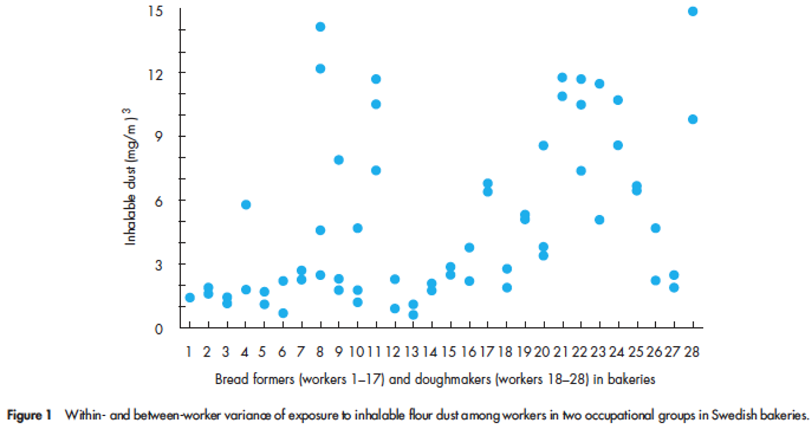
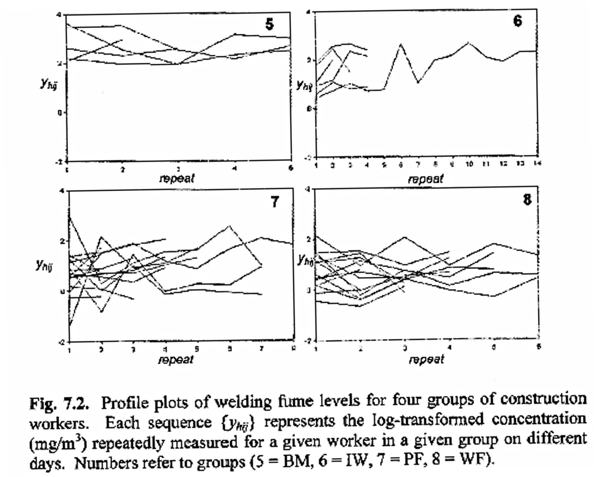
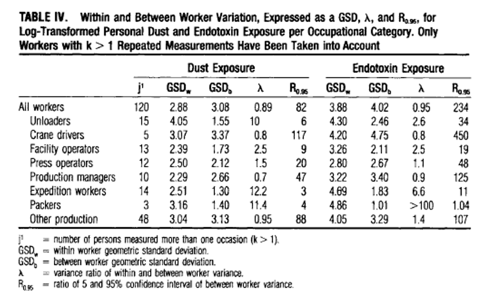
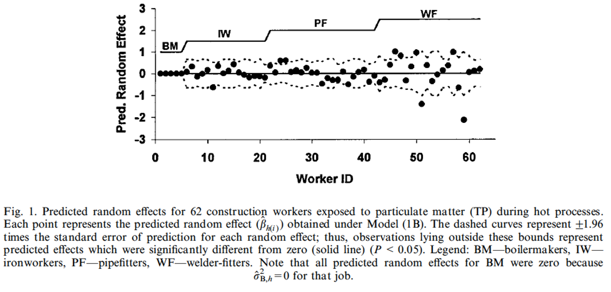
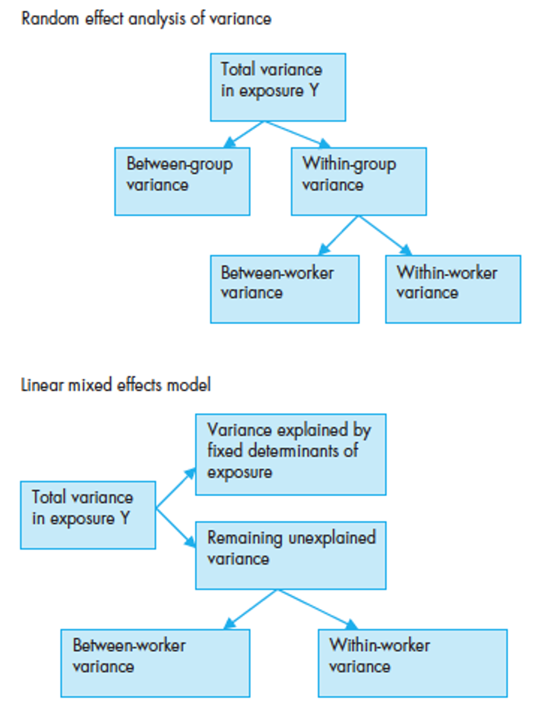
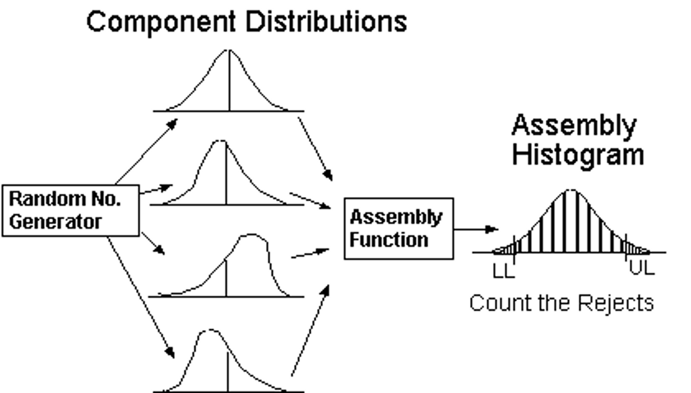
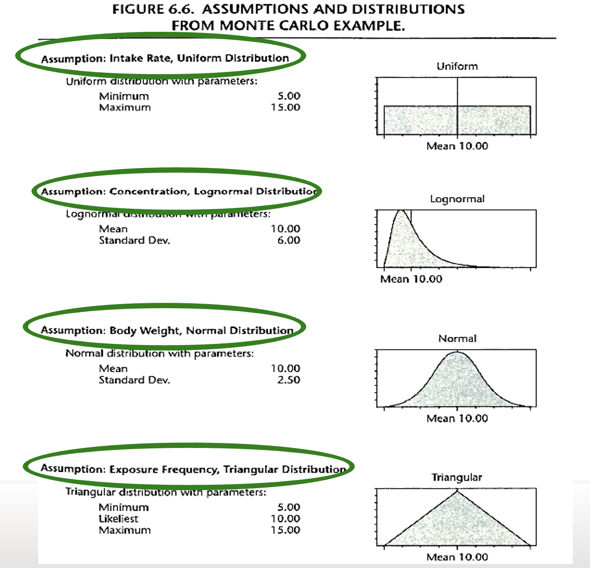
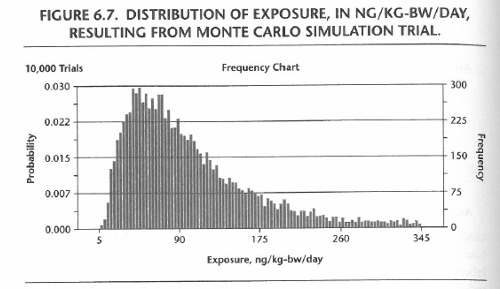
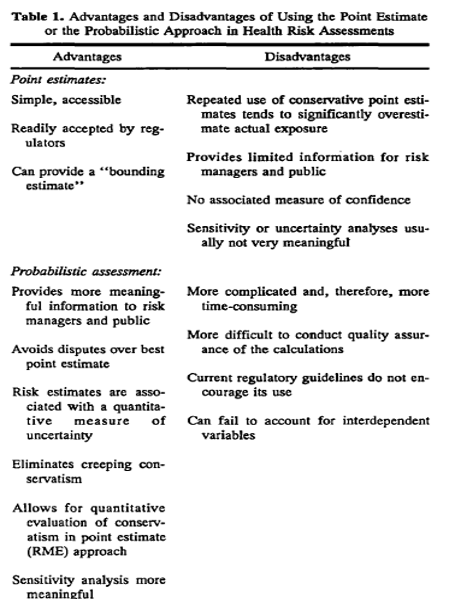

::: {.content-visible when-format="revealjs"}

------------------------------------------------------------------------

## Lecture 16: Exposure variability and modeling

------------------------------------------------------------------------
:::

::: {.content-hidden when-format="revealjs"}
```{r, message=FALSE, warning=FALSE}
#| code-fold: true
#| code-summary: "Click to view catchup R code"

# set your working directory with `setwd()`!!

# load packages we need
library(tidyverse) # data manipulation and plotting
library(readxl) # reading in our excel dataset
library(janitor) # cleaning columns names and more
library(lme4) # for mixed effects models
library(lmerTest) # for 

# set the theme of all ggplots to `theme_minimal()`
theme_set(theme_minimal())

# read dataset excel file and make sure it's a tibble
#### note new dataset file name
ehs655_v2 <- read_xlsx("Dataset V2.xlsx") %>% as_tibble()

# make all column names lowercase and snake_case
ehs655_v2 <- ehs655_v2 %>% clean_names()

# clean job title variable to remove misspellings
ehs655_v2 <- ehs655_v2 %>%
  mutate(
    job_title = 
      case_when(
        job_title == "Lborer" ~ "Laborer",
        job_title == "Laboerr" ~ "Laborer",
        job_title == "Electrican" ~ "Electrician",
        job_title == "Carpentr" ~ "Carpenter",
        job_title == "Operaing engineer" ~ "Operating engineer",
        job_title == "Ironworkr" ~ "Ironworker",
        job_title == "" ~ NA,
        .default = job_title))

# clean gender variable to fix multiple classification schemes
ehs655_v2 <- ehs655_v2 %>%
  mutate(
    gender = 
      case_when(
        gender == "M" ~ "Male",
        gender == "F" ~ "Female",
        .default = gender))

# convert LEQ values <LOD to LOD/sqrt(2)
ehs655_v2 <- ehs655_v2 %>%
  mutate(work_leq_d_ba = ifelse(work_leq_d_ba < 70, 70/sqrt(2), work_leq_d_ba))

# estimate time-weighted averages for each shift
ehs655_v2 <- ehs655_v2 %>%
  mutate(TWA = work_leq_d_ba + 10*log10(measured_shift_length_mins/480))

# estimate peakiness for each shift
ehs655_v2 <- ehs655_v2 %>%
  mutate(peakiness = lmax_d_ba_shift/work_leq_d_ba)

# dropping bad cases of TWA and Lmax based on calibration
ehs655_v2 <- ehs655_v2 %>%
  mutate(TWA = ifelse(post_cal_value_d_ba < 113.5 | 
                        post_cal_value_d_ba > 114.5,
                      NA,
                      TWA)) %>%
  mutate(lmax_d_ba_shift = ifelse(is.na(TWA),
                                  NA,
                                  lmax_d_ba_shift))

# keeping only good cases of 70 <= Lmax <= 140 dBA based on physical bounds
ehs655_v2 <- ehs655_v2 %>%
  mutate(lmax_d_ba_shift = ifelse(lmax_d_ba_shift < 70,
                                  70,
                                  lmax_d_ba_shift)) %>%
  mutate(lmax_d_ba_shift = ifelse(lmax_d_ba_shift > 140,
                                  140,
                                  lmax_d_ba_shift))

# order perceived noise levels from low to high
ehs655_v2 <- ehs655_v2 %>%
  mutate(perceived_noise_level_shift =
           factor(perceived_noise_level_shift,
                  levels = c("Low", "Moderate", "High")))

# create binary noise exposure outcome
ehs655_v2 <- ehs655_v2 %>%
  mutate(bin_TWA = ifelse(TWA > 85, 1, 0)) 
```
:::

### What we'll cover today

- More on the repeated measurements in our dataset

- Within- and between-subjects variability

- Variance components

- Fixed, random, and mixed effects

------------------------------------------------------------------------

### Repeated measures

- Handling our (newly added) repeated measurements?

  - Need to report measurements by shift and by person

- `mutate()` to the rescue!

  - Generate count of TWA measurements within subject

    ```{r}
    ehs655_v2 <- ehs655_v2 %>%
      group_by(subject_id) %>%
      mutate(count_TWA = sum(!is.na(TWA))) %>%
      ungroup() # so R doesn't make all analyses by subject_id

    ehs655_v2 %>% tabyl(count_TWA)
    ```

------------------------------------------------------------------------

### Example of noise exposure calculation requiring transformation

- Can describe noise exposures (in dBA) [**across individuals arithmetically**]{.underline}

  - i.e., use arithmetic mean of measurements in group as group mean

- To estimate average noise exposures [**within individual**]{.underline} (in dBA) is computing dose

  - Requires temporary transformation

  - $L_{EQ_i} = 10 \text{log}[1/N(10^{(TWA_1/10)}) + 1/N(10^{(TWA_2/10)}) + ... + 1/N(10^{(TWA_n/10)})]$

  - Where $N$ is total number of TWAs used to estimate average $L_{EQ}$ for person $i$

- How to operationalize in R?

------------------------------------------------------------------------

### Computing avg across repeated measures within subject

::::: columns-only-on-slides
::: slide-column
1.  Generate antilog of TWA measurements

    ```{r}
    ehs655_v2 <- ehs655_v2 %>% 
      mutate(pascals = 10^(TWA/10))
    ```

2.  Generate average exposure across rows within subject

    ```{r}
    ehs655_v2 <- ehs655_v2 %>% 
      group_by(subject_id) %>% 
      mutate(subject_pascals = mean(pascals, na.rm = TRUE)) %>%
      ungroup()
    ```

3.  Take log of calculate value

    ```{r}
    ehs655_v2 <- ehs655_v2 %>% 
      mutate(subject_TWA = 10*log10(subject_pascals))
    ```
:::

::: slide-column
Analyze data

```{r}
ehs655_v2 %>%
  ggplot(aes(x = as.character(count_TWA), y = subject_TWA)) +
  geom_boxplot()
```
:::
:::::

------------------------------------------------------------------------

### Residuals

- How to get residual values from model predictions?

  - Residuals: difference between modeled and observed values

  ```{r, warning=FALSE, message=FALSE}
  mod1 <- ehs655_v2 %>% 
    lmer(TWA ~ age_baseline_years + (1|subject_id), data = .)
  ```

- To get estimated residual values is similar to `predict()`

  ```{r}
  ehs655_v2 %>% 
    filter(!is.na(TWA)) %>% # remove missing TWA values
    mutate(pred_TWA = predict(mod1, newdata = .)) %>%
    mutate(resid_TWA = residuals(mod1, newdata = .)) %>%
    ggplot(aes(x = pred_TWA, y = resid_TWA)) +
    geom_point()
  ```

------------------------------------------------------------------------

### Within- and between-person variability

- We’ve already talked about within- and between group variability

  - What about variability at individual level?

- Between-person variability

  - Reflects differences between workers beyond those explained by shared characteristics (e.g., workplace)

- Within-person variability

  - Reflects variability due to day-to-day differences in exposure

------------------------------------------------------------------------

### Example: within- and between-person variability

{width="90%"}

::: custom-footer
A Burdorff 2005
:::

------------------------------------------------------------------------

### Example: within-person variability between groups

{width="70%"}

::: custom-footer
Rappaport, 2008
:::

------------------------------------------------------------------------

### How do we evaluate within- and between-person variability?

- Step 1: measure it

  - Need repeated measurements on individuals

- Step 2: analyze it

  - Need to evaluate variance components

  - Within-person Between-person

- Why do we care?

  - Relative importance of day-to-day differences in exposure vs between-worker differences

  - Useful when considering approaches to exposure control

------------------------------------------------------------------------

### Exercise

- Why do we care about variance components?

  - Think about how within-person variability applies to exposure controls

- For which jobs do you think training and personal protective equipment might be more or less effective at controlling exposures?

  - Welder: $\downarrow$ within-person, $\uparrow$ between-person

  - Mechanic: $\uparrow$ within-person, $\uparrow$ between-person

  - Assembler: $\downarrow$ within-person, $\downarrow$ between-person

------------------------------------------------------------------------

### Variance components

$$
\sigma_T^2 = \sigma_W^2 + \sigma_B^2
$$

Where

- Total variance: $\sigma_T^2$

- Within-person variance: $\sigma_W^2$

- Between-person variance: $\sigma_B^2$

$\sigma_W^2$ required repeated measure on inviduals

------------------------------------------------------------------------

### Variance (actually SD) components example - job title

{width="90%"}

::: custom-footer
Heederik, Bolei, Kromhout, Smid, 1991
:::

------------------------------------------------------------------------

### How to get estimates of within-, between-person variance?

- We’ve already been considering fixed effects Shared characteristic (e.g., workplace, department)

  - Average response of group from common regression model

- Now we can add random effects

  - Allows estimation of responses for each individual (i.e., accounts for individual variability)

- Mixed models include both effects

------------------------------------------------------------------------

### Fixed vs random effects

{width="95%"}

::: custom-footer
Rappaport et al, Ann Occup Hyg, 1999
:::

------------------------------------------------------------------------

### Mixed effects regression

- Strengths

  - Can address work characteristics

  - Can evaluate variance components

  - Can consider several sources of variability

- One continuous dependent variable (linear regression)

- One binary dependent variable (logistic regression)

- One to many categorical or continuous independent variables

------------------------------------------------------------------------

### Mixed effects linear regression

- Includes both fixed and random effects

  - Fixed effect: same coefficient applied to all in group

  - Random effect: coefficients vary by individual, site, or some other factor

- Estimates within- and between-person variance while adjusting for fixed effects

------------------------------------------------------------------------

### Example: fixed vs mixed effects model

Let's compare the results of a fixed effects and a mixed effects model in our dataset

::::: columns-only-on-slides
::: slide-column
```{r}
# fixed effects
ehs655_v2 %>%
  lm(TWA ~ job_title + perceived_noise_level_shift, data = .) %>%
  summary()
```
:::

::: slide-column
```{r}
# mixed effects
ehs655_v2 %>%
  lmer(TWA ~ job_title + perceived_noise_level_shift + (1|subject_id), 
       data = .) %>%
  summary()
```
:::
:::::

------------------------------------------------------------------------

### Comparing models

- Can use statistical metrics like AIC

  - Absolute number meaningless, lower values better

  - R: `AIC(model)`

- Better to think through what variables are important

  - We are interested in drawing inferences from our models (think EPI 101)

  - Are you missing any potential confounders?

  - Is it plausible that the included variables affect the outcome?

  - Do you have redundant (highly correlated) variables in the same model?

------------------------------------------------------------------------

### Within- and between-person variance

Review

{width="40%"}

::: custom-footer
A Burdorff 2005
:::

------------------------------------------------------------------------

### Why care about within-, between-person variance

- To understand importance of

  - Day to day differences in exposure

  - Differences in exposure between workers

- Help guide future measurements

  - More repeated measurements vs more subjects?

- Help determine exposure controls

  - Focus on group vs focus on individual

  - Within-person variance \>\> between person $\rightarrow$ driven by general environmental conditions

  - Between-person variance \>\> within person $\rightarrow$ driven by individual behaviors

------------------------------------------------------------------------

### Probabilistic analysis

- More computationally challenging than deterministic models (e.g., regression models we have explored)

- Provides ability to consider

  - Population distributions

  - Sources and magnitude of uncertainty

- Monte Carlo simulation approach often used

  - Draws randomly from defined distributions

  - Repeat this over and over to create new distribution

------------------------------------------------------------------------

### How probabilistic analysis works

{width="85%"}

------------------------------------------------------------------------

### Example probabilistic approach - component distributions

- What goes into dose estimate for ingested chemicals?

  - Intake rate

  - Concentration

  - Body weight

  - Exposure frequency

{width="60%"}

------------------------------------------------------------------------

### Example probabilistic analysis results

{width="90%"}

------------------------------------------------------------------------

### Replicating in R

::::: columns-only-on-slides
::: slide-column
Run Monte Carlo simulation (exposure as a function of intake and concentration)

```{r}
r_intake <- runif(n = 10000, min = 5, max = 15)
r_concentration <- rlnorm(n = 10000, meanlog = log(10), sdlog = 0.35)
exposure <- r_concentration*r_intake
```
:::

::: slide-column
Prep custom theme to replicate figure style

```{r}
theme_simulation <- function() {
  theme_minimal() + # Start with a clean base
    theme(
      # --- Panel Bounding Box & Background ---
      panel.background = element_rect(fill = "white", color = "black", linewidth = 0.8),
      plot.background  = element_rect(fill = "white", color = NA),
      
      # --- Gridlines (Horizontal only, solid and dark) ---
      panel.grid.major.y = element_line(color = "#777777", linewidth = 0.5),
      panel.grid.major.x = element_blank(),
      panel.grid.minor   = element_blank(),
      
      # --- Ticks and Axes ---
      axis.ticks        = element_line(color = "black", linewidth = 0.5),
      axis.ticks.length = unit(4, "pt"),
      
      # --- Text & Typography ---
      text = element_text(family = "sans", color = "black"),
      
      # Centered Main Chart Title
      plot.title = element_text(
        hjust = 0.5, 
        size = 14, 
        face = "plain", 
        margin = margin(b = 10)
      ),
      
      # Top-Left "Trials" Metadata Label
      plot.tag = element_text(
        size = 10, 
      ),
      plot.tag.position = c(0.1, 0.99),
      
      # Axis Labels and Titles
      axis.title.x = element_text(size = 11, margin = margin(t = 10)),
      axis.title.y = element_text(size = 11, margin = margin(r = 10)),
      axis.text    = element_text(size = 10, color = "black"),
      
      # Clean up any default margins
      plot.margin = margin(t = 15, r = 15, b = 15, l = 15)
    )
}
```
:::
:::::

------------------------------------------------------------------------

### Replicating figure

::::: columns-only-on-slides
::: slide-column
Run ggplot code

```{r, warning=FALSE, message=FALSE}
replicated_plot <- tibble(exposure) %>%
  ggplot(aes(x = exposure)) +
  # Draw the gray histogram bars with white separation borders
  geom_histogram(
    aes(y = after_stat(density)), 
    binwidth = 3, 
    fill = "grey45", 
    color = "white", 
    linewidth = 0.1
  ) +
  # Match the axis limits and define the secondary Frequency scale
  scale_y_continuous(
    labels = scales::label_number(accuracy = 0.001),
    limits = c(0, 0.01), # Set exact min and max boundaries
    expand = expansion(mult = c(0, 0)), 
    sec.axis = sec_axis(
      transform = ~ . * (10000 * 3), # Adjust scaling factor based on binwidth & rows
      name = "Frequency"
    )
  ) +
  scale_x_continuous(
    breaks = c(5, 90, 175, 260, 345),
    limits = c(0, 360)
  ) +
  # Add exact labels matching your screenshot
  labs(
    title = "Frequency Chart",
    tag = "10,000 Trials",
    x = "Exposure, ng/kg-bw/day",
    y = "Probability"
  ) +
  # Apply our custom simulation theme
  theme_simulation()
```
:::

::: slide-column
```{r, echo=FALSE, warning=FALSE, message=FALSE}
replicated_plot
```
:::
:::::

------------------------------------------------------------------------

### Probabilistic models

{width="65%"}

::: custom-footer
Finley BL, Paustenbach DJ. 1994
:::
