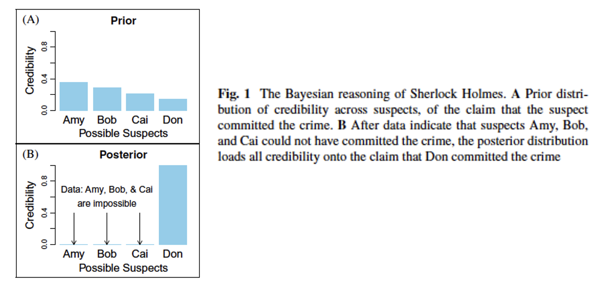
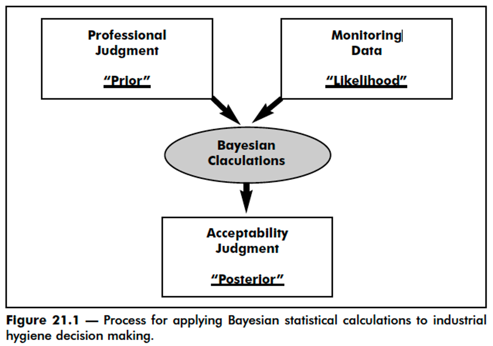
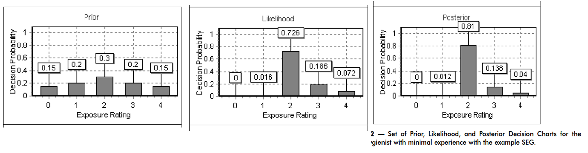
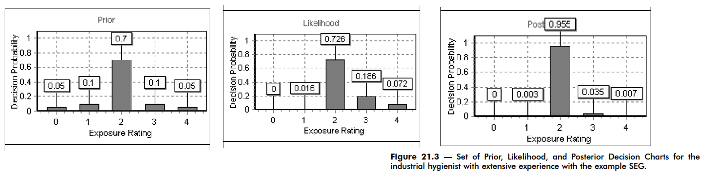
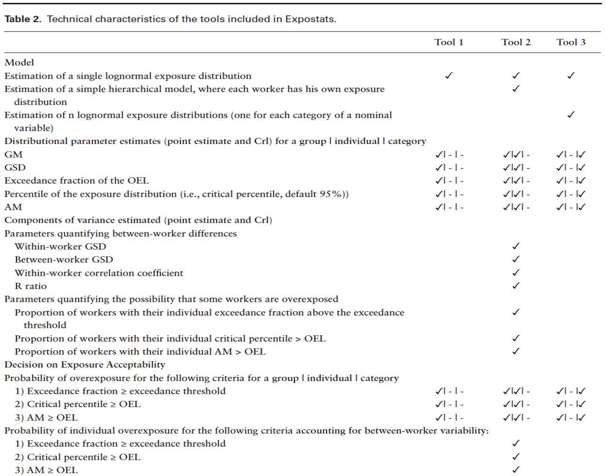

::: {.content-visible when-format="revealjs"}

------------------------------------------------------------------------

## Lecture 17: Bayesian analysis

------------------------------------------------------------------------
:::

### What we'll cover today

- Bayesian analysis

- Assignment 4

------------------------------------------------------------------------

### Bayesian analysis

- Basically what Sherlock Holmes did

  - “When you have eliminated the impossible, whatever remains, however improbable, must be the least bad option from among the possibilities you are considering.”

{width="80%"}

::: custom-footer
Kruschke JK, Liddell TM. 2018
:::

------------------------------------------------------------------------

### Bayesian analysis

{width="70%"}

::: custom-footer
AIHA *Exposure Assessment Manual*, 3rd ed, 2006
:::

------------------------------------------------------------------------

### Bayesian analysis example: IH with minimal experience

{width="95%"}

::: custom-footer
AIHA *Exposure Assessment Manual*, 3rd ed, 2006
:::

------------------------------------------------------------------------

### Bayesian analysis example: IH with extensive experience

{width="95%"}

::: custom-footer
AIHA *Exposure Assessment Manual*, 3rd ed, 2006
:::

------------------------------------------------------------------------

### Bayesian analysis tool: Expostats

Free online tool to aid with exposure analysis

Actually 3 tools in 1

<http://www.expostats.ca/site/en/tools.html>

{width="60%"}

------------------------------------------------------------------------

### Coding Expostats ourselves in R

- We will conduct the Bayesian analysis in the library `rstanarm`

- This will not replicate Expostats exactly since it uses a slightly different Bayesian model

- We will use `rstanarm` because it is simpler to run

- You can view the exact model specifications of Expostats at <https://github.com/webexpo/webexpo_r_lib/tree/master>

- We will focus on Tool 1 only here: <https://lavoue.shinyapps.io/tool1/?lang=en&mode=extended>

------------------------------------------------------------------------

### Tool 1: Data Interpretation for One Similar Exposure Group (SEG)

```{r, message=FALSE}
# install packages if needed
### install.packages("tidyverse")
### install.packages("rstanarm")

# load libraries
library(tidyverse)
library(rstanarm)
```

Let's set the calculation parameters as you would on the webpage

```{r}
# define occupational exposure limit
oel <- 100
# define oel multiplier
oel_multiplier <- 1
# define credible interval probaility 
cri_prob <- 90
# define overexposure risk threshold
overexop_thr <- 30
# define exposures
exposures <- c(28.9, 19.4, 3.9, 149.9, 26.42, 56.1)
```

Prep data to run Bayesian model

```{r}
df_exposure <- tibble(log_exp = log(exposures/oel))
```

Run Bayesian model using `rstanarm:stan_glm()`

Formally,

$$
\text{log}(X_i/\text{OEL}) \sim N(\mu, \sigma^2)
$$

where:

- $\mu \sim N(0, 10^2)$, while Expostats uses $U(-20, 20)$

- $\sigma \sim \text{half-normal}(0, 2^2)$, while Expostats uses a lognormal prior with log-mean of $-0.1744$ and log-SD of $1/\sqrt{2.5523}$

```{r}
tool1_bayes <- rstanarm::stan_glm(
  log_exp ~ 1,
  data = df_exposure,
  family = gaussian(link = "identity"),
  prior_intercept = rstanarm::normal(
    location = 0,
    scale = 10,
    autoscale = FALSE
  ),
  prior_aux = rstanarm::normal(
    location = 0,
    scale = 2,
    autoscale = FALSE
  ),
  chains = 4,
  iter = 4000,
  warmup = 2000,
  seed = 12345,
  adapt_delta = 0.99,
  refresh = 0
)

draws <- as.matrix(tool1_bayes)

# mu is on the log(X/OEL) scale throughout this function.
mu <- draws[, "(Intercept)"]
sigma <- draws[, "sigma"]
```

### Statistical Inference

Get summary statistics

```{r, warning=FALSE, message=FALSE}
tibble(exposures) %>%
  summarise(
    `Number of observations` = n(),
    `Minimum` = min(exposures),
    `2.5th percentile` = quantile(exposures, probs = 0.25),
    Median = median(exposures),
    `75th percenitle` = quantile(exposures, probs = 0.75),
    Maximum = max(exposures),
    `Proportion >OEL` = 100*sum(exposures>100)/n(),
    `Arithmetic Mean` = mean(exposures),
    `Arithmetic SD` = sd(exposures),
    `Coefficient of Variation` = 100*sd(exposures)/mean(exposures),
    `Geometric Mean` = exp(mean(log(exposures))),
    `Geometric SD` = exp(sd(log(exposures)))
  ) %>%
  gather(`Sample Statistic`, `Value`) %>%
  mutate(Value = round(Value, 1)) %>%
  print(n = 12)
```

Create Q-Q plot

```{r}
df_exposure %>%
  ggplot(aes(sample = log_exp)) +
  stat_qq() +
  stat_qq_line() +
  labs(x = "Quantiles (Lognormal Distribution)",
       y = "Quantiles (Standardized Distribution)")
```

Box and whiskers plot

```{r}
tibble(exposures, label = "Measurement") %>%
  ggplot(aes(x = label, y = exposures)) +
  geom_boxplot(width = 0.5) +
  geom_jitter() +
  geom_hline(yintercept = oel, color = "red") +
  annotate("text", label = "OEL", x = 0.8, y = 110, color = "red") +
  labs(x = NULL, y = "Concentrations")
```

### Exceedence Fraction

**Risk assessment: probability of overexposure**

- Overexposure is defined as the exceedance fraction being greater than or equal to 5%.

- An exposure exceeds the OEL of 100 when $\text{log}(X/\text{OEL}) > 0$

- In other words

  $$
  P(X > \text{OEL}) = P(\text{log}(X/\text{OEL}) > 0) \\
  = 1 - \Phi(\frac{0-\mu}{\sigma}) \\
  = 1 - \Phi(-\frac{\mu}{\sigma}) \\
  = \Phi(\frac{\mu}{\sigma})
  $$

```{r}
exceedance <- pnorm(mu/sigma)
exceedance_fraction <- 100*sum(exceedance > 0.05)/length(exceedance)
exceedance_fraction
```

So, the probability of overexposure is 90.4%, while the probability should be no more than 30%. This means the situation is problematic.

**Estimates**

- We can get a 90% credible interval for the geometric mean of exposures as well as for the exceedance fraction

```{r}
# geometric mean
gm <- oel*exp(mu)
round(quantile(gm, probs = c(0.5, 0.05, 0.95)), 1)
```

The geometric mean is 28.4 (90% credible interval: 10.1-77.3)

```{r}
# exceedance fraction
round(quantile(exceedance, probs = c(0.5, 0.05, 0.95))*100, 1)
```

The exceedance fraction is 17.2% (90% credible interval: 3.3-44.2%)

**Risk-band plot**

```{r}
tibble(exceedance) %>%
  mutate(categories = cut(exceedance, breaks = c(0, 0.005, 0.05, 1))) %>%
  mutate(categories = factor(categories, labels = c("EF ≤ 0.5%", "0.5% < EF ≤ 5%", "EF > 5%"))) %>%
  group_by(categories) %>%
  summarise(probability = 100*round(n()/8000, 3)) %>%
  ggplot(aes(x = categories, y = probability, fill = categories)) +
  geom_col(width = 0.5) +
  geom_text(aes(label = probability, y = probability + 5)) +
  scale_fill_manual(values = c("green", "yellow", "red")) +
  ylim(c(0, 100)) +
  theme(legend.position = "none") +
  labs(x = "Exceedance Fraction Category", y = "Probability (%)")
```

### Arithmetic Mean

**Risk assessment**

- Overexposure is defined as the arithmetic mean being greater than or equal to the OEL (100 in this case).

- For reasons we won't show here, the arithmetic mean of a lognormal distribution is $\text{AM} = \text{OEL} * \text{exp}(\mu + \frac{\sigma^2}{2})$

```{r}
arithmetic_mean <- oel * exp(mu + 0.5 * sigma^2)
arithmetic_mean_exceedance <- 100*sum(arithmetic_mean > oel)/length(arithmetic_mean)
arithmetic_mean_exceedance
```

So, the probability of overexposure is 30.7%, while the probability should be no more than 30%. This means the situation is problematic.

**Estimates**

- We can get a 90% credible interval for the arithmetic mean of exposures

```{r}
round(quantile(arithmetic_mean, probs = c(0.5, 0.05, 0.95)), 1)
```

**Risk-band plot**

```{r}
tibble(arithmetic_mean) %>%
  mutate(normalized = arithmetic_mean/oel) %>%
  mutate(categories = cut(normalized, breaks = c(0, 0.01, 0.1, 0.5, 1, Inf))) %>%
  mutate(categories = factor(categories, levels = c("(0,0.01]", "(0.01,0.1]", "(0.1,0.5]", "(0.5,1]", "(1,Inf]"), labels = c("OEL ≤ 1%", "1% < OEL ≤ 10%", "10% < OEL ≤ 50%", "50% < OEL ≤ 100%", "OEL > 100%"))) %>%
  group_by(categories) %>%
  summarise(probability = 100*round(n()/8000, 3)) %>%
  ggplot(aes(x = categories, y = probability)) +
  geom_col(width = 0.5) +
  geom_text(aes(label = probability, y = probability + 5)) +
  scale_x_discrete(drop = FALSE) +
  ylim(c(0, 100)) +
  theme(legend.position = "none") +
  labs(x = "Exceedance Fraction Category", y = "Probability (%)")
```
