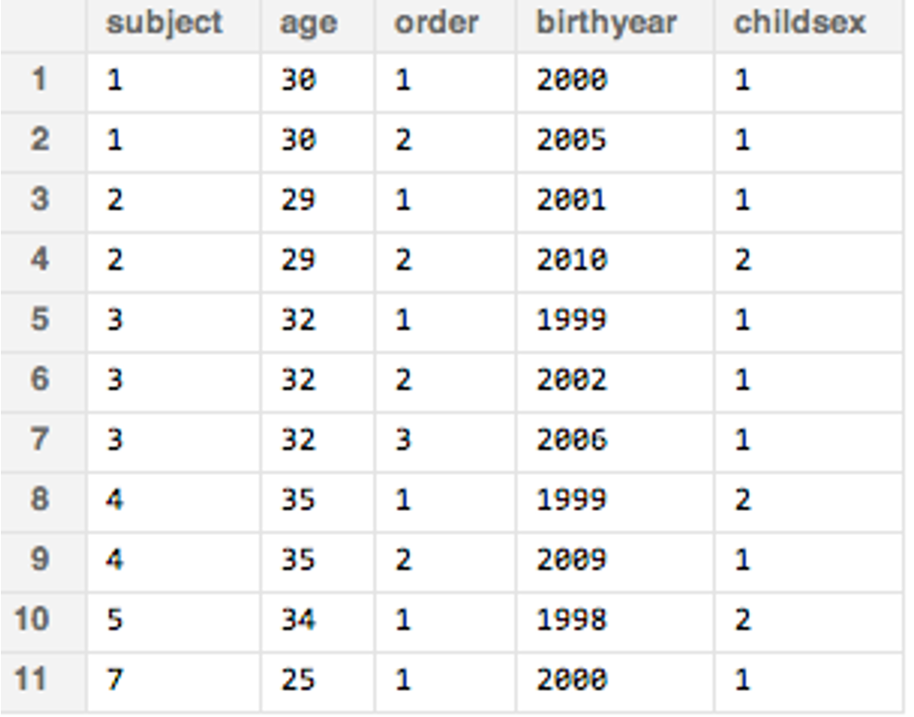
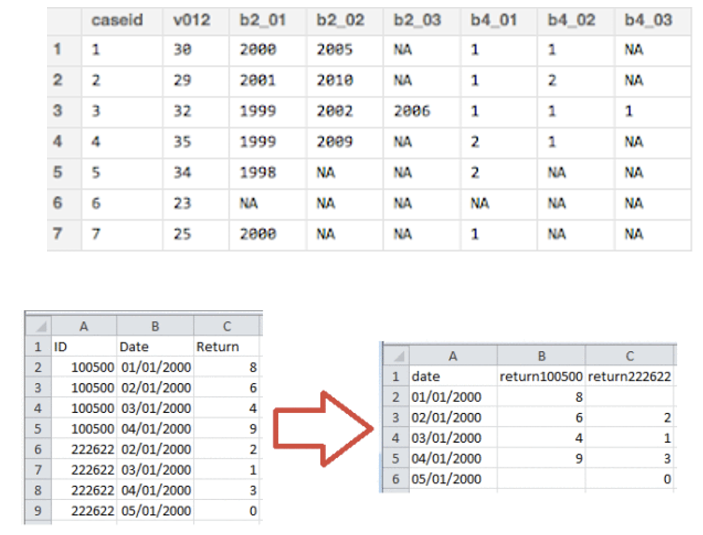
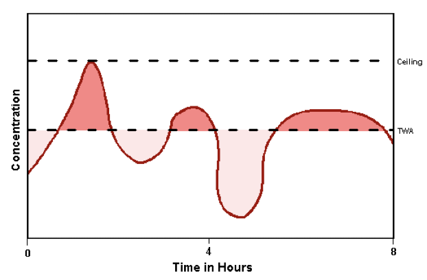

::: {.content-visible when-format="revealjs"}

------------------------------------------------------------------------

## Lecture 18: Moving from shift-level to study-level exposures

------------------------------------------------------------------------
:::

::: {.content-hidden when-format="revealjs"}
```{r, message=FALSE, warning=FALSE}
#| code-fold: true
#| code-summary: "Click to view catchup R code"

# set your working directory with `setwd()`!!

# load packages we need
library(tidyverse) # data manipulation and plotting
library(readxl) # reading in our excel dataset
library(janitor) # cleaning columns names and more
library(lme4) # for mixed effects models
library(lmerTest) # for 

# set the theme of all ggplots to `theme_minimal()`
theme_set(theme_minimal())

# read dataset excel file and make sure it's a tibble
#### note new dataset file name
ehs655_v2 <- read_xlsx("Dataset V2.xlsx") %>% as_tibble()

# make all column names lowercase and snake_case
ehs655_v2 <- ehs655_v2 %>% clean_names()

# clean job title variable to remove misspellings
ehs655_v2 <- ehs655_v2 %>%
  mutate(
    job_title = 
      case_when(
        job_title == "Lborer" ~ "Laborer",
        job_title == "Laboerr" ~ "Laborer",
        job_title == "Electrican" ~ "Electrician",
        job_title == "Carpentr" ~ "Carpenter",
        job_title == "Operaing engineer" ~ "Operating engineer",
        job_title == "Ironworkr" ~ "Ironworker",
        job_title == "" ~ NA,
        .default = job_title))

# clean gender variable to fix multiple classification schemes
ehs655_v2 <- ehs655_v2 %>%
  mutate(
    gender = 
      case_when(
        gender == "M" ~ "Male",
        gender == "F" ~ "Female",
        .default = gender))

# convert LEQ values <LOD to LOD/sqrt(2)
ehs655_v2 <- ehs655_v2 %>%
  mutate(work_leq_d_ba = ifelse(work_leq_d_ba < 70, 70/sqrt(2), work_leq_d_ba))

# estimate time-weighted averages for each shift
ehs655_v2 <- ehs655_v2 %>%
  mutate(TWA = work_leq_d_ba + 10*log10(measured_shift_length_mins/480))

# estimate peakiness for each shift
ehs655_v2 <- ehs655_v2 %>%
  mutate(peakiness = lmax_d_ba_shift/work_leq_d_ba)

# dropping bad cases of TWA and Lmax based on calibration
ehs655_v2 <- ehs655_v2 %>%
  mutate(TWA = ifelse(post_cal_value_d_ba < 113.5 | 
                        post_cal_value_d_ba > 114.5,
                      NA,
                      TWA)) %>%
  mutate(lmax_d_ba_shift = ifelse(is.na(TWA),
                                  NA,
                                  lmax_d_ba_shift))

# keeping only good cases of 70 <= Lmax <= 140 dBA based on physical bounds
ehs655_v2 <- ehs655_v2 %>%
  mutate(lmax_d_ba_shift = ifelse(lmax_d_ba_shift < 70,
                                  70,
                                  lmax_d_ba_shift)) %>%
  mutate(lmax_d_ba_shift = ifelse(lmax_d_ba_shift > 140,
                                  140,
                                  lmax_d_ba_shift))

# order perceived noise levels from low to high
ehs655_v2 <- ehs655_v2 %>%
  mutate(perceived_noise_level_shift =
           factor(perceived_noise_level_shift,
                  levels = c("Low", "Moderate", "High")))

# create binary noise exposure outcome
ehs655_v2 <- ehs655_v2 %>%
  mutate(bin_TWA = ifelse(TWA > 85, 1, 0)) 

# generate count of repeated samples
ehs655_v2 <- ehs655_v2 %>%
  group_by(subject_id) %>%
  mutate(count_TWA = sum(!is.na(TWA))) %>%
  ungroup() # so R doesn't make all analyses by subject_id

# compute average TWA for each subject
## generate antilog of TWA
ehs655_v2 <- ehs655_v2 %>% 
  mutate(pascals = 10^(TWA/10))

## generate average pascal for each subject
ehs655_v2 <- ehs655_v2 %>% 
  group_by(subject_id) %>% 
  mutate(subject_pascals = mean(pascals, na.rm = TRUE)) %>%
  ungroup()

## take log of subject-level pascals
ehs655_v2 <- ehs655_v2 %>% 
  mutate(subject_TWA = 10*log10(subject_pascals))
```
:::

### What we'll cover today

- Our current exposure prediction models: shift-level

- Where we need to get to: study-level

- How to get from point A to point B

------------------------------------------------------------------------

### Exposure prediction model: shift-level

- Dependent variable

  - Measured TWA noise exposure

- Independent variable(s) – static or time-varying?

  - Demographic attributes?

  - Work characteristics?

  - Other?

- Complication

  - Presence of repeated exposure measurements

------------------------------------------------------------------------

### Static exposure factors

- Some exposure factors do not vary with time

  - Job title

  - Sex

  - Perhaps others?

- Exposure predictions based on these factors are simplest

  - e.g., no variation over time

------------------------------------------------------------------------

### Time-varying exposure factors

- Many/most exposure factors vary over time

  - Task

  - Perceived noise level

  - Site type

- Exposures predicted from these factors more complicated

  - Need to account for variation over time

------------------------------------------------------------------------

### A moment on dataset format: long vs wide

- Our dataset is long

- Advantages

  - Optimal for single measurement per subject, all exposure factors static

  - Easily handles repeated observations, especially when n of observations differs between subjects

- Disadvantages

  - Harder to connect multiple measurements to single outcome

{width="55%"}

------------------------------------------------------------------------

### Datasets: wide vs long

- Advantages

  - Optimal if all subjects have same number of measures

  - Easier to connect multiple observations with single outcome

- Disadvantages

  - Complicated if differing numbers of repeated measures

  - Can switch between wide and long

    - But won’t need to in this class

{width="50%"}

------------------------------------------------------------------------

### Our exposure estimates so far: primarily shift-level

- Our exposure prediction models estimate exposure associated with individual with given set of predictor variables

- In our case, an 8-hour TWA exposure level in dBA

- *Note: we did look at person-levelexposures in assignment 4*

  {width="60%"}

------------------------------------------------------------------------

### Exposure prediction model: study-level

- Take prediction model from shift-level and apply coefficients to estimate study-level exposures

  - Reminder: “shift” variables summarize single workshift, “study” variables summarize entire follow-up period

- **Complication: need to account for exposure/follow-up duration**

{width="50%"}

------------------------------------------------------------------------

### Steps for creating study-level exposure predictions

- STEP 1: Create workshift-level exposure model to predict workshift TWA, $\hat{X}_{shift}$

- STEP 2: Use $\hat{X}_{shift}$ coefficients from shift-level regression model to create $\hat{X}_{study}$ study-level regression model

- STEP 3: Adjust for exposure duration

------------------------------------------------------------------------

### Step 1. Predict workshift-level exposure: $\hat{X}_{shift}$

- Use trade, shift task, and/or other variable(s) to estimate shift exposures via mixed effects regression

  - We’ve already done this

  - Yields intercept, slope coefficient for each exposure determinant

- Major issues we need to address in our dataset

  - Subjects with repeated exposure measurements have health outcomes at only one time point

  - Subject “-study” and “shift” factors may differ, e.g.

    - Shift primary task different than study primary task

    - Shift perceived noise level different than study perceived level

    - Shift other high noise different than study other high noise, etc.

------------------------------------------------------------------------

### Step 2. Use shift-level model to estimate study-level exposure

- Laborious, but forces you to understand model

- Create dummy variables for each determinant in model

- Manually create regression predictions for each subject based on “study” factors

  - I.e., code your regression equation into Stata manually

- Delete all but one observation per subject

  - They’ll all have same predicted study-level exposure, so only need to keep one

------------------------------------------------------------------------

### Step 2. Use shift-level model to estimate study-level exposure

E.g., run mixed effects model for TWA by shift-level perceived noise

```{r}
mod_shiftlevel <- ehs655_v2 %>% 
  lmer(TWA ~ perceived_noise_level_shift + (1|subject_id), data = .)
summary(mod_shiftlevel)
```

------------------------------------------------------------------------

### Step 2. Use shift-level model to estimate study-level exposure

- After running shift-level regression, create dummy variables for each study-level predictor in model

  - In this case, my model has only ranked perceived noise level, but yours may have more variables

  - Don't need a dummy variable for reference level ("Low")

```{r}
# order study-level perceived noise levels from low to high
ehs655_v2 <- ehs655_v2 %>%
  mutate(perceived_noise_level_study =
           factor(perceived_noise_level_study,
                  levels = c("Low", "Moderate", "High")))

# create dummy variables
ehs655_v2 <- ehs655_v2 %>%
  mutate(perceived_noise_level_study_moderate = 
           ifelse(perceived_noise_level_study == "Moderate",
                  1, 0)) %>%
  mutate(perceived_noise_level_study_high = 
           ifelse(perceived_noise_level_study == "High",
                  1, 0))
```

------------------------------------------------------------------------

### Step 2. Use shift-level model to estimate study-level exposure

- Manually create regression estimates for each subject based on “study” factors

  $\hat{X}_{study} = \beta_0 + \beta_1X_1 + \beta_2X_2 + ... + \beta_NX_N + \alpha_i$

- Extract coefficients from model (for those with missing TWA, we need to assign them the fixed intercept from the model, or global mean)

  ```{r}
  # store random intercepts
  ranef_shiftlevel <- coef(mod_shiftlevel)[[1]]
  # convert random intercepts to tibble
  ranef_shiftlevel <- tibble(
    subject_id = as.numeric(rownames(ranef_shiftlevel)),
    intercept = ranef_shiftlevel$`(Intercept)`
  )
  ranef_shiftlevel

  # store fixed effects
  fixef_shiftlevel <- fixef(mod_shiftlevel)
  fixef_shiftlevel

  # merge model coefficients with our data
  ehs655_v2 <- ehs655_v2 %>%
    # bring in random intercepts
    full_join(ranef_shiftlevel, by = "subject_id") %>%
    # assign global mean for those with missing TWA
    mutate(intercept = ifelse(is.na(intercept), fixef_shiftlevel[[1]], intercept)) %>%
    # bring in fixed effects for perceived noise
    mutate(coef_moderate = fixef_shiftlevel[[2]],
           coef_high = fixef_shiftlevel[[3]])
  ```

------------------------------------------------------------------------

### Step 2. Use shift-level model to estimate study-level exposure

- Estimate `study_TWA` from our model example

  ```{r}
  ehs655_v2 <- ehs655_v2 %>%
    mutate(study_TWA = intercept + coef_moderate*perceived_noise_level_study_moderate + coef_high*perceived_noise_level_study_high)
  ```

- Compare with empirical `subject_TWA` computed last week

  ```{r}
  ehs655_v2 %>% ggplot(aes(x = subject_TWA, y = study_TWA)) + geom_point()
  ```

------------------------------------------------------------------------

### Step 3: accounting for exposure duration

- May use single variable or combination of variables to determine total exposure duration

- If all exposures of same duration, end there (easy)

- If exposures of different duration, 3 options (harder)

  - Compute total duration

  - Compute cumulative exposure

  - Normalize exposures to standardized duration

------------------------------------------------------------------------

### Duration of exposure - option 1

- Compute total duration

  - May be hours, months, years, decades, etc

  - May simply be elapsed time since baseline, or actual hours of exposure to an agent

- Model separately from exposure level (!)

  - In other words, include as covariate

- e.g., hours/week \* weeks/year = hours/year

  - Study follow-up (years) \* hours/week \* weeks/year = total hours

------------------------------------------------------------------------

### Step 3: accounting for exposure duration, option 1

First, compute study exposure duration: $T_{study}$

- $T_{study} = (hours/week) * (weeks/year) * (years)$

- Units are in hours of exposure

```{r}
ehs655_v2 <- ehs655_v2 %>%
  mutate(t_study = usual_hours_worked_per_week * usual_weeks_worked_per_year * study_follow_up_period_years)

hist(ehs655_v2$t_study)
```

Could simply add this into model as covariate

- Not desirable; exposure not independent of duration

------------------------------------------------------------------------

### Duration of exposure - option 2

- Compute cumulative exposure

  - Duration x intensity – in our case, in dBA x years

- Cannot compute until finished estimating exposure intensity

  - We’ll come back to this

------------------------------------------------------------------------

### Step 3: accounting for exposure duration, option 2

Estimate cumulative exposure from $T_{study}$ and $\hat{X}_{study}$

$cumStudyTWA = 10*\text{log}_{10}(T_{study} * 10 ^ {\hat{X}_{study} /10})$

Where

- $\hat{X}_{study}$ is estimated exposure level (step 2)

- $T_{study}$ is study exposure duration (hrs)

  - Note units of dBA-years

```{r}
ehs655_v2 <- ehs655_v2 %>%
  mutate(cum_study_TWA = 10*log10(t_study*(10^(study_TWA/10))))

hist(ehs655_v2$cum_study_TWA)
```

------------------------------------------------------------------------

### Duration of exposure - option 3

- Normalize exposure to standardized duration

  - Where durations vary widely between subjects, consider normalizing exposures

- Possible options:

  - Standard work year (2000 hours)

  - 1 calendar year

- Cannot compute until finished estimating exposure intensity

  - We’ll come back to this

------------------------------------------------------------------------

### Step 3: accounting for exposure duration, option 3

Estimate normalized time-weighted average exposure from $T_{study}$, $\hat{X}_{study}$, and follow-up years

$normStudyTWA = \hat{X}_{study} + 10*\text{log}_{10}(\frac{T_{study}}{2000*F})$

Where

- $\hat{X}_{study}$ is estimated exposure level

- $T_{study}$ is study exposure duration (hrs)

- $F$ is duration of follow up (yrs)

- $2000$ is 2,000 hrs/yr (standard work year)

```{r}
ehs655_v2 <- ehs655_v2 %>%
  mutate(norm_study_TWA = study_TWA + 10*log10(t_study/(2000*study_follow_up_period_years)))

hist(ehs655_v2$norm_study_TWA)
```

------------------------------------------------------------------------

### Comparing person-level TWA measurements

::::: columns-only-on-slides
::: slide-column
Observed, average TWA (`subject_TWA`) vs cumulative exposure (`cum_study_TWA`)

```{r}
ehs655_v2 %>%
  ggplot(aes(x = subject_TWA, y = cum_study_TWA)) +
  geom_point(aes(color = subject_id)) +
  theme(legend.position = "none")
```
:::

::: slide-column
Observed, average TWA (`subject_TWA`) vs normalized TWA (`norm_study_TWA`)

```{r}
ehs655_v2 %>%
  ggplot(aes(x = subject_TWA, y = norm_study_TWA)) +
  geom_point(aes(color = subject_id)) +
  theme(legend.position = "none")
```
:::
:::::
